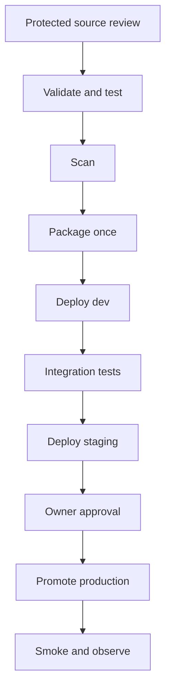
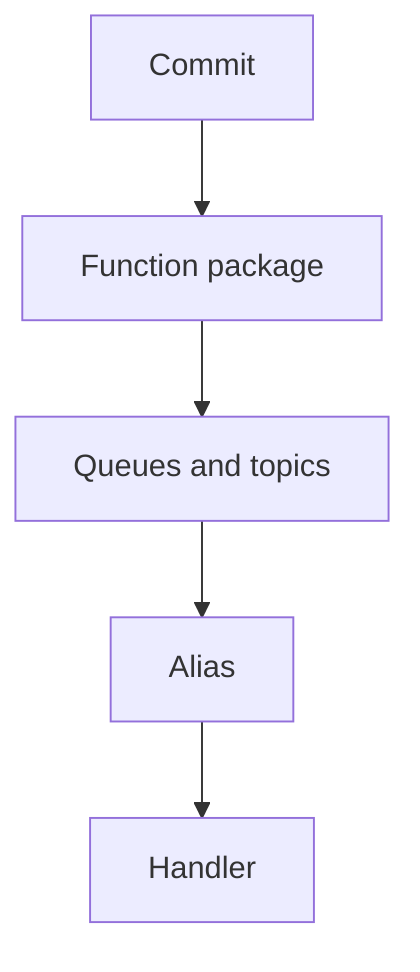

# P23 Banking Notification Service CI CD On AWS

**Cloud:** AWS  
**Industry:** Banking  
**Project type:** Development  
**Resume occurrences:** 3

[Back to project index](README.md)

This guide preserves the extracted resume content and expands it into a proposed implementation flow. Confirm actual application and infrastructure details before using it as an execution runbook. Lab occurrences remain lab work.

## End to end objectives and CI/CD implementation

This is a complete reference delivery design for this title, including orchestration YAML, script contracts and project-specific execution. The actual application repository, credentials, resource names and infrastructure were not provided. The YAML will not deploy a real project until those values and the required project-owned scripts and Make targets are implemented and tested.

### A. Project objectives

- Business objective: Developed automated delivery for banking notification functions with repeatable messaging resources and release validation.
- Technical objective: implement the specific path Commit > Function package > Queues and topics > Alias > Handler using the resume stack: AWS Lambda, SQS, SNS, CodePipeline, CodeBuild, Terraform, IAM.
- Acceptance objective: Synthetic messages reach expected handlers.
- Recovery objective: detect routing or permissions block notifications and rehearse this response: Restore alias and messaging settings; reconcile messages before replay.
- Delivery objective: test and package one approved revision, validate it in isolated environments and promote the same release bundle through controlled production delivery.

### B. Business flow and delivery flow

**Business or operational path:** Commit > Function package > Queues and topics > Alias > Handler.




The pipeline transports **Function ZIP, published version, alias and messaging infrastructure**. Source review, build/test signals and deployment identity are separate controls. One CI bundle is promoted through all environments; production does not fetch a new branch head. For container deployments, build and scan the image in CI, record its digest in the payload manifest and reuse that digest instead of rebuilding it per environment.

### C. Repository layout


```text
projects/P23/                  # application, runbook or migration source
infra/P23/                     # reviewed resource definitions and provider locks
environments/dev/                # non-secret dev configuration
environments/staging/            # non-secret staging configuration
environments/prod/               # non-secret prod configuration
scripts/P23/ci.sh
scripts/P23/verify-release.sh
scripts/P23/preflight.sh
scripts/P23/plan.sh
scripts/P23/execute.sh
scripts/P23/verify.sh
scripts/P23/rollback.sh
tests/P23/                     # unit, integration, negative and recovery tests
pipelines/P23/                 # pipeline YAML and buildspec files
Makefile                         # validate, test, scan and package targets
release/                         # generated artifacts; never commit credentials
```

### D. Environment and access preparation

1. Prepare an approved CodeConnections connection and set FullRepositoryId to the actual owner/repository and the intended protected branch. Confirm the connection is authorized before creating the pipeline.
2. Create a restricted encrypted artifact bucket and separate CodeBuild CI, dev, staging and production role ARNs. The template references existing roles; it does not create wildcard IAM grants. Scope the pipeline role to the connection, required build projects and artifact objects.
3. Allow CI only the package/registry operations it needs. Limit each deployment role to its intended environment resources and approved runtime role passing. Never put long-lived access keys in the buildspec.
4. Configure artifact access, encryption-key permissions, logging, retention and private VPC connectivity when required. These organization-specific controls are intentionally not fabricated in this template.
5. Review the CodeBuild agent image and pin/install the needed tools. The example uses a standard Linux image; validate availability in the selected region. Docker builds require a reviewed isolated Docker-capable builder; the sample does not silently enable privileged mode.
6. Configure protected branch review, notification routing and approval permissions. A support deployment approval is not automatic permission to restart a production service or replay business events.

### E. AWS CodePipeline and CodeBuild YAML

Save the template as `pipelines/P23/codepipeline.yml` and both buildspecs under the same directory. Supply the existing role ARNs, artifact bucket, connection and repository parameters when deploying the CloudFormation template. It creates the orchestration and four build projects; it does not provision the application target or its IAM roles.

**CodePipeline and CodeBuild resource template**

```yaml
AWSTemplateFormatVersion: '2010-09-09'
Description: P23 reference delivery orchestration — Banking Notification Service CI CD On AWS
Parameters:
  ArtifactBucket:
    Type: String
  PipelineRoleArn:
    Type: String
  CiRoleArn:
    Type: String
  DevRoleArn:
    Type: String
  StagingRoleArn:
    Type: String
  ProdRoleArn:
    Type: String
  ConnectionArn:
    Type: String
  FullRepositoryId:
    Type: String
  BranchName:
    Type: String
    Default: main
Resources:
  CIProject:
    Type: AWS::CodeBuild::Project
    Properties:
      ServiceRole:
        Ref: CiRoleArn
      Artifacts:
        Type: CODEPIPELINE
      Source:
        Type: CODEPIPELINE
        BuildSpec: pipelines/P23/buildspec-ci.yml
      Environment:
        Type: LINUX_CONTAINER
        ComputeType: BUILD_GENERAL1_SMALL
        Image: aws/codebuild/standard:7.0
        PrivilegedMode: false
        EnvironmentVariables:
        - Name: PROJECT_ID
          Value: P23
          Type: PLAINTEXT
  DevProject:
    Type: AWS::CodeBuild::Project
    Properties:
      ServiceRole:
        Ref: DevRoleArn
      Artifacts:
        Type: CODEPIPELINE
      Source:
        Type: CODEPIPELINE
        BuildSpec: pipelines/P23/buildspec-deploy.yml
      Environment:
        Type: LINUX_CONTAINER
        ComputeType: BUILD_GENERAL1_SMALL
        Image: aws/codebuild/standard:7.0
        PrivilegedMode: false
        EnvironmentVariables:
        - Name: PROJECT_ID
          Value: P23
          Type: PLAINTEXT
        - Name: TARGET_ENV
          Value: dev
          Type: PLAINTEXT
        - Name: CHANGE_MODE
          Value: delivery
          Type: PLAINTEXT
  StagingProject:
    Type: AWS::CodeBuild::Project
    Properties:
      ServiceRole:
        Ref: StagingRoleArn
      Artifacts:
        Type: CODEPIPELINE
      Source:
        Type: CODEPIPELINE
        BuildSpec: pipelines/P23/buildspec-deploy.yml
      Environment:
        Type: LINUX_CONTAINER
        ComputeType: BUILD_GENERAL1_SMALL
        Image: aws/codebuild/standard:7.0
        PrivilegedMode: false
        EnvironmentVariables:
        - Name: PROJECT_ID
          Value: P23
          Type: PLAINTEXT
        - Name: TARGET_ENV
          Value: staging
          Type: PLAINTEXT
        - Name: CHANGE_MODE
          Value: delivery
          Type: PLAINTEXT
  ProdProject:
    Type: AWS::CodeBuild::Project
    Properties:
      ServiceRole:
        Ref: ProdRoleArn
      Artifacts:
        Type: CODEPIPELINE
      Source:
        Type: CODEPIPELINE
        BuildSpec: pipelines/P23/buildspec-deploy.yml
      Environment:
        Type: LINUX_CONTAINER
        ComputeType: BUILD_GENERAL1_SMALL
        Image: aws/codebuild/standard:7.0
        PrivilegedMode: false
        EnvironmentVariables:
        - Name: PROJECT_ID
          Value: P23
          Type: PLAINTEXT
        - Name: TARGET_ENV
          Value: prod
          Type: PLAINTEXT
        - Name: CHANGE_MODE
          Value: delivery
          Type: PLAINTEXT
  Pipeline:
    Type: AWS::CodePipeline::Pipeline
    Properties:
      RoleArn:
        Ref: PipelineRoleArn
      ArtifactStore:
        Type: S3
        Location:
          Ref: ArtifactBucket
      Stages:
      - Name: Source
        Actions:
        - Name: Source
          ActionTypeId:
            Category: Source
            Owner: AWS
            Provider: CodeStarSourceConnection
            Version: '1'
          Configuration:
            ConnectionArn:
              Ref: ConnectionArn
            FullRepositoryId:
              Ref: FullRepositoryId
            BranchName:
              Ref: BranchName
            DetectChanges: 'true'
          InputArtifacts: []
          OutputArtifacts:
          - Name: SourceArtifact
          RunOrder: 1
      - Name: CI
        Actions:
        - Name: ValidatePackage
          ActionTypeId:
            Category: Build
            Owner: AWS
            Provider: CodeBuild
            Version: '1'
          Configuration:
            ProjectName:
              Ref: CIProject
          InputArtifacts:
          - Name: SourceArtifact
          OutputArtifacts:
          - Name: ReleaseArtifact
          RunOrder: 1
      - Name: Dev
        Actions:
        - Name: DevChange
          ActionTypeId:
            Category: Build
            Owner: AWS
            Provider: CodeBuild
            Version: '1'
          Configuration:
            ProjectName:
              Ref: DevProject
            PrimarySource: SourceArtifact
          InputArtifacts:
          - Name: SourceArtifact
          - Name: ReleaseArtifact
          OutputArtifacts:
          - Name: DevEvidence
          RunOrder: 1
      - Name: Staging
        Actions:
        - Name: StagingChange
          ActionTypeId:
            Category: Build
            Owner: AWS
            Provider: CodeBuild
            Version: '1'
          Configuration:
            ProjectName:
              Ref: StagingProject
            PrimarySource: SourceArtifact
          InputArtifacts:
          - Name: SourceArtifact
          - Name: ReleaseArtifact
          OutputArtifacts:
          - Name: StagingEvidence
          RunOrder: 1
      - Name: ApproveProduction
        Actions:
        - Name: OwnerApproval
          ActionTypeId:
            Category: Approval
            Owner: AWS
            Provider: Manual
            Version: '1'
          Configuration:
            CustomData: 'P23: review staging results, target plan, reconciliation and recovery before approval'
          InputArtifacts: []
          OutputArtifacts: []
          RunOrder: 1
      - Name: Prod
        Actions:
        - Name: ProductionChange
          ActionTypeId:
            Category: Build
            Owner: AWS
            Provider: CodeBuild
            Version: '1'
          Configuration:
            ProjectName:
              Ref: ProdProject
            PrimarySource: SourceArtifact
          InputArtifacts:
          - Name: SourceArtifact
          - Name: ReleaseArtifact
          OutputArtifacts:
          - Name: ProdEvidence
          RunOrder: 1
Outputs:
  PipelineName:
    Value:
      Ref: Pipeline
```

**CI buildspec — buildspec-ci.yml**

```yaml
version: '0.2'
env:
  shell: bash
  variables:
    PROJECT_ID: P23
phases:
  build:
    commands:
    - set -euo pipefail
    - export COMMIT_SHA="$CODEBUILD_RESOLVED_SOURCE_VERSION"
    - bash scripts/P23/ci.sh
artifacts:
  base-directory: release
  files:
  - '**/*'
```

**Deployment buildspec — buildspec-deploy.yml**

```yaml
version: '0.2'
env:
  shell: bash
phases:
  build:
    commands:
    - 'set -euo pipefail

      export RELEASE_DIR="$CODEBUILD_SRC_DIR_ReleaseArtifact"

      export REPORT_DIR="$CODEBUILD_SRC_DIR/reports"

      export PLAN_DIR="$CODEBUILD_SRC_DIR/restricted"

      mkdir -p "$REPORT_DIR" "$PLAN_DIR" "$CODEBUILD_SRC_DIR/work"

      bash "$RELEASE_DIR/verify-release.sh" "$RELEASE_DIR"

      tar -xzf "$RELEASE_DIR/source.tgz" -C "$CODEBUILD_SRC_DIR/work"

      cd "$CODEBUILD_SRC_DIR/work"

      bash scripts/P23/preflight.sh "$TARGET_ENV" "$RELEASE_DIR" "$REPORT_DIR"

      bash scripts/P23/plan.sh "$TARGET_ENV" "$RELEASE_DIR" "$REPORT_DIR"

      bash scripts/P23/execute.sh "$TARGET_ENV" "$RELEASE_DIR" "$REPORT_DIR"

      bash scripts/P23/verify.sh "$TARGET_ENV" "$RELEASE_DIR" "$REPORT_DIR"'
artifacts:
  base-directory: reports
  files:
  - '**/*'
```

The source artifact is primary so CodeBuild can resolve the buildspec. The immutable release is the additional artifact named `ReleaseArtifact`, exposed through `CODEBUILD_SRC_DIR_ReleaseArtifact`. The deployment executes the source archive inside that approved bundle; the primary source is not used as a new deployment revision.

### F. CI packaging and immutable promotion

Save this wrapper as `scripts/P23/ci.sh`. Its Make targets are application/project-owned integration points, not included application source. Implement them according to the contract below. Payloads must contain the selected deployment unit and relevant test reports; avoid sensitive data and unencrypted Terraform state or plans.


```bash
#!/usr/bin/env bash
set -euo pipefail
: "${PROJECT_ID:?Set PROJECT_ID}"
: "${COMMIT_SHA:?Set COMMIT_SHA}"
# Required project-owned targets; implement these against the selected language and tools.
make validate PROJECT_ID="$PROJECT_ID"
make test PROJECT_ID="$PROJECT_ID"
make scan PROJECT_ID="$PROJECT_ID"
mkdir -p release/payload
make package PROJECT_ID="$PROJECT_ID" OUTPUT_DIR="$PWD/release/payload"
# CI source artifacts may be extracted ZIPs with no .git directory.
tar --exclude='./release' --exclude='./reports' --exclude='./.git' -czf release/source.tgz .
printf '%s\n' "$COMMIT_SHA" > release/source-revision.txt
printf '%s\n' "$PROJECT_ID" > release/project-id.txt
# A digest detects accidental changes; bucket/artifact access controls provide trust.
(cd release && find payload -type f -print0 | sort -z | xargs -0 -r sha256sum; sha256sum source.tgz source-revision.txt project-id.txt) > release/SHA256SUMS
cp "scripts/$PROJECT_ID/verify-release.sh" release/verify-release.sh
```

Save this verifier as `scripts/P23/verify-release.sh`.


```bash
#!/usr/bin/env bash
set -euo pipefail
bundle="${1:?Release directory required}"
cd "$bundle"
test -s source-revision.txt
test -s project-id.txt
test -f source.tgz
# Reject archive paths that could escape the isolated extraction directory.
if tar -tzf source.tgz | grep -Eq '(^/|(^|/)\.\.(/|$))'; then
  echo "Unsafe source archive path" >&2
  exit 1
fi
sha256sum -c SHA256SUMS
```

### G. Required script and artifact contracts

All scripts use `set -euo pipefail`, reject missing required values, avoid shell tracing of secrets and exit nonzero on a failed assertion. Stage hooks take three arguments: environment, release directory and report directory. They must put sanitized evidence into the report directory and keep sensitive plans/state in a separately restricted store.

| File or target | Project-specific implementation | Required behavior |
| --- | --- | --- |
| make validate | Lint application, infrastructure and deployment definitions | Exit nonzero on invalid inputs, missing schemas or invalid environment configuration. |
| make test | Run unit and contract tests plus safe fixtures for Banking Notification Service CI CD On AWS | Produce results without contacting production systems. |
| make scan | Run pinned secret, dependency and infrastructure scans relevant to the selected stack | Fail on the project-approved blocking rules and store sanitized results. |
| make package | Function ZIP, published version, alias and messaging infrastructure | Write versioned deliverables under OUTPUT_DIR; do not put secrets or sensitive inventories in the bundle. |
| preflight.sh | Verify target account/subscription, region, identity, required variables and rollback availability | Record the target and stop on mismatch. Assert CHANGE_MODE and TARGET_ENV before mutation. |
| plan.sh | Generate the intended deployment or infrastructure change plan | Save sanitized plan and stop conditions to REPORT_DIR; plan is not permission to perform destructive work. |
| execute.sh | Package functions with reviewed message contracts; Provision messaging resources, identities and settings; Test delivery, permissions and failed-event handling; Promote the alias and inspect retry and processing behavior | In dev/staging use isolated targets. In prod perform only the approved change; keep retirement, destructive cleanup and incident replay separately authorized. |
| verify.sh | Synthetic messages reach expected handlers | Test complete user paths and negative cases; exit nonzero on failure and record safe evidence. |
| rollback.sh | Restore alias and messaging settings; reconcile messages before replay | Require a selected accepted release and reconciliation decision; validate target identity and capture recovery results. Never silently auto-rollback data. |
| verify-release.sh | Validate immutable bundle paths and SHA256SUMS before extraction | Digest checks do not substitute for restricted artifact-store permissions. |

### H. Title-specific execution sequence

1. **Package functions with reviewed message contracts.** Record the relevant resource or revision, the validation result and the accepted next state before continuing. In production, use the scope accepted by the named owner; the pipeline must not broaden its own authority.
2. **Provision messaging resources, identities and settings.** Record the relevant resource or revision, the validation result and the accepted next state before continuing. In production, use the scope accepted by the named owner; the pipeline must not broaden its own authority.
3. **Test delivery, permissions and failed-event handling.** Record the relevant resource or revision, the validation result and the accepted next state before continuing. In production, use the scope accepted by the named owner; the pipeline must not broaden its own authority.
4. **Promote the alias and inspect retry and processing behavior.** Record the relevant resource or revision, the validation result and the accepted next state before continuing. In production, use the scope accepted by the named owner; the pipeline must not broaden its own authority.

The following fragment illustrates the platform boundary for this project; fill its required variables from validated non-secret environment configuration and secure references. It is a fragment to integrate into the hooks, not a replacement for the full preflight, approval and verification flow.


```bash
version=$(aws lambda update-function-code --region "$AWS_REGION" \
  --function-name "$FUNCTION_NAME" --zip-file "fileb://$RELEASE_DIR/payload/function.zip" \
  --publish --query Version --output text)
aws lambda wait function-updated --region "$AWS_REGION" --function-name "$FUNCTION_NAME"
aws lambda update-alias --region "$AWS_REGION" --function-name "$FUNCTION_NAME" \
  --name "$ALIAS" --function-version "$version"
# Publish code only after reviewed configuration readiness; validate queue/topic tests next.
```

### I. Dev to staging to production walkthrough

| Stage | End to end behavior |
| --- | --- |
| Source review | A developer changes the source/configuration relevant to this title, links the work item and obtains required protected-branch review. CI validation is required before merge. |
| CI validation | Run the project-specific Make targets, test fixtures and blocking security rules. Failed scans or tests stop the release before any production credentials are used. |
| Package | Produce Function ZIP, published version, alias and messaging infrastructure. Record the commit and file digests. Preserve immutable registry/package identifiers if an external registry is involved. |
| Dev | Validate account/subscription and run preflight, plan, execute and verify against isolated resources. Package functions with reviewed message contracts. |
| Staging | Use representative isolated dependencies and rehearse the complete path, including routing or permissions block notifications. Capture rollback and reconciliation results. |
| Approval | An owner reviews the source revision, artifact identity, staging tests, target impact, recovery readiness and any data reconciliation. Reject stale plans or unresolved business-state uncertainty. |
| Production | Recheck the real target and allowed scope, then promote the exact bundle. Promote the alias and inspect retry and processing behavior. Stop on failed assertions. |
| Verification | Acceptance is: Synthetic messages reach expected handlers. Technical deployment success without application-path tests is insufficient. |
| Recovery | On failure, stop further changes and preserve evidence. Restore alias and messaging settings; reconcile messages before replay. A separate controlled rollback uses rollback.sh and the previously accepted compatible release; the sample pipeline deliberately does not invoke an indiscriminate automatic rollback. |
| Handover | Publish sanitized execution results and named monitoring ownership. Keep source retirement, destructive cleanup, backlog replay and retention decisions separate from deployment completion. |

### J. Production stop conditions and acceptance

- Stop if the account/subscription, environment, approved revision or identity differs from the change record.
- Stop if any required test, signature/digest check, access review or plan comparison fails.
- Stop if business state is uncertain; resolve duplicate writes, files, messages or jobs with the application/data owner before retry or failback.
- Stop if routing or permissions block notifications.
- Accept only when synthetic messages reach expected handlers and the owner accepts monitoring and recovery readiness.
- Do not use fabricated latency, availability, transaction-volume or savings claims. Choose actual thresholds and observation windows with the owner.

### K. Platform reference documentation

- [AWS connection source action](https://docs.aws.amazon.com/codepipeline/latest/userguide/action-reference-CodestarConnectionSource.html)
- [CodeBuild action and multiple input artifacts](https://docs.aws.amazon.com/codepipeline/latest/userguide/action-reference-CodeBuild.html)
- [CodeBuild buildspec reference](https://docs.aws.amazon.com/codebuild/latest/userguide/build-spec-ref.html)

## Detailed application, operations and recovery flow

The original complete project flow follows, including the extracted resume description, architecture, ten execution stages, tests, monitoring, incident response, security and resume references.

## Extracted resume content

**Extracted from the resumes**

Developed automated delivery for banking notification functions with repeatable messaging resources and release validation.

Skills used: AWS Lambda, SQS, SNS, CodePipeline, CodeBuild, Terraform, IAM

- Created function-package pipelines with automated checks and versioned release artifacts.
- Provisioned queues, topics and application identities through reviewed infrastructure modules.
- Configured alias-based promotion and validated message-handler connectivity using test events.
- Documented release approvals, failed-event diagnostics and rollback to a prior function version.
- Reviewed environment variables, dependency versions and deployment prerequisites before each planned release.
- Recorded build identifiers, test results and release approvals to support traceability and operational handover.

## 1. Purpose and implementation boundary

This development flow concerns Banking Notification Service CI CD On AWS. Proposed acceptance condition: Synthetic messages reach expected handlers. The detailed sequence below is a planning and learning expansion of the resume, not proof that these steps were performed in a client environment.

Confirm application language, repository URL, exact resource names, account or subscription structure, regions, versions, client identity, traffic volumes, SLOs, data-retention requirements and approval owners. These are not supplied in the resumes and are not invented here.

## 2. Architecture and main flow



**Flow:** Commit → Function package → Queues and topics → Alias → Handler

The boxes show logical boundaries, not a verified deployed topology. Keep build or change identity separate from runtime identity; carry a release, incident or migration identifier across logs and handover records.

**Decision gate**

All stage checks pass? Continue to the next stage. A check fails? Stop promotion or traffic movement, preserve diagnostics and assess recovery. A business side effect may already exist? Reconcile it with the application owner before replay, rerun or failback.

## 3. Prerequisites and ownership

| Owner | Required input | Completion responsibility |
| --- | --- | --- |
| Application owner | Expected user journeys, dependencies, data contract and test examples | Accept functional behavior and reconcile business state |
| DevOps engineer | Source revision, resource inventory, pipeline access and tool configuration | Implement reviewed changes and capture validation results |
| Platform and identity owner | Network paths, deployment identity, runtime roles and approved secret references | Approve scoped access and environment readiness |
| QA or lab reviewer | Controlled fixtures and acceptance cases | Verify normal, negative and recovery behavior |
| Operations or incident owner | Baseline signals, alert routing and recovery contacts | Own monitoring, incident escalation and handover |
| Data owner when applicable | Authoritative copy, writer controls and reconciliation method | Approve synchronization, replay, data recovery and retention |

## 4. Detailed execution flow

### 1. Confirm release scope

**Owner:** DevOps and application owner

Input: Approved work item and source requirements

Action: Define environment boundaries, expected application behavior, release ownership and the test cases needed for Banking Notification Service CI CD On AWS.

Output and gate: Reviewed scope, dependency inventory and acceptance criteria

If the gate fails: Do not begin implementation if runtime or data ownership is unclear.

### 2. Prepare delivery foundations

**Owner:** DevOps and platform owner

Input: Repository access and approved environment design

Action: Prepare version control, protected review, isolated test resources and scoped deployment identity. Use the resume tools as the starting stack; confirm omitted details before implementation.

Output and gate: Reviewed repository and environment baseline

If the gate fails: Resolve missing access through the owner; do not weaken environment controls.

### 3. Establish a reproducible baseline

**Owner:** DevOps and QA

Input: A known application revision and controlled fixtures

Action: Run the existing build or setup, record its identifiers and validate a synthetic baseline. Define how configuration and secrets differ between environments.

Output and gate: Repeatable build or setup and reference test results

If the gate fails: Stop if baseline behavior cannot be reproduced consistently.

### 4. Execute project stage 1

**Owner:** DevOps engineer with service owner

Input: Accepted output of the preceding stage and relevant resume tools

Action: Package functions with reviewed message contracts. Validate the result before moving to the next boundary in the architecture flow.

Output and gate: Stage record identifying the exact resource or revision, check performed and result

If the gate fails: On failure, stop progression and inspect routing or permissions block notifications. Retain the last accepted state.

### 5. Execute project stage 2

**Owner:** DevOps engineer with service owner

Input: Accepted output of the preceding stage and relevant resume tools

Action: Provision messaging resources, identities and settings. Validate the result before moving to the next boundary in the architecture flow.

Output and gate: Stage record identifying the exact resource or revision, check performed and result

If the gate fails: On failure, stop progression and inspect routing or permissions block notifications. Retain the last accepted state.

### 6. Execute project stage 3

**Owner:** DevOps engineer with service owner

Input: Accepted output of the preceding stage and relevant resume tools

Action: Test delivery, permissions and failed-event handling. Validate the result before moving to the next boundary in the architecture flow.

Output and gate: Stage record identifying the exact resource or revision, check performed and result

If the gate fails: On failure, stop progression and inspect routing or permissions block notifications. Retain the last accepted state.

### 7. Execute project stage 4

**Owner:** DevOps engineer with service owner

Input: Accepted output of the preceding stage and relevant resume tools

Action: Promote the alias and inspect retry and processing behavior. Validate the result before moving to the next boundary in the architecture flow.

Output and gate: Stage record identifying the exact resource or revision, check performed and result

If the gate fails: On failure, stop progression and inspect routing or permissions block notifications. Retain the last accepted state.

### 8. Validate the complete application path

**Owner:** QA and application owner

Input: Completed technical steps and controlled fixtures

Action: Exercise the complete path through Queues and topics to Alias to Handler. Check a normal request, an access-denied case and a failed dependency. Reconcile any partial writes or repeated events.

Output and gate: Synthetic messages reach expected handlers.

If the gate fails: If any acceptance check fails, keep the change unaccepted and use the recovery decision below.

### 9. Approve completion and observe stability

**Owner:** Change or incident owner

Input: Functional results and monitoring baseline

Action: Confirm that expected AWS logs, resource health and application signals are visible. Compare with the accepted baseline for an owner-agreed observation period; do not invent numerical SLOs or durations.

Output and gate: Owner sign-off, observation record and resolved exceptions

If the gate fails: Reopen the incident or stop the cutover when regression exceeds agreed limits.

### 10. Hand over and close

**Owner:** DevOps and operations owner

Input: Accepted service state and open follow-up actions

Action: Publish the runbook, version or configuration references, recovery procedure, alert ownership and known limitations. For migrations, defer source retirement until retention and reconciliation are signed off.

Output and gate: Operational handover and tracked follow-up work

If the gate fails: Leave risky cleanup or retirement pending rather than treating technical completion as automatic approval.

## 5. Project-specific integration checks

| Boundary | Required checks |
| --- | --- |
| Message contract | Define schema version, correlation identifier, delivery acknowledgement, retry limit, dead-letter handling and idempotency key. Test a repeated event and a partially completed handler before enabling replay. |
| Delivery integration | Inventory triggers, branch rules, agent capabilities, environment approvals and connection identities. Prevent old and new triggers from starting the same production deployment. |
| Infrastructure state | Review resource ownership, remote-state permissions, serialization, imports and replacement plans. Preserve a state backup and compare actual resources before recovering from a partial apply. |

## 6. Validation matrix

| Test | Execution | Acceptance |
| --- | --- | --- |
| Normal flow | Run one controlled example across the complete architecture path | Synthetic messages reach expected handlers |
| Denied access | Use a test identity without the required role | Access is denied, sanitized diagnostics are available and no permissions are broadened |
| Project failure | Rehearse this failure in isolation: Routing or permissions block notifications | The failure is detected and the runbook identifies a bounded response |
| Unavailable dependency | Use a controlled dependency failure or safely simulated unavailable endpoint | Errors remain visible and the recovery path does not create uncontrolled retries |
| Repeated execution | Repeat the test or stage only in an isolated environment with a known initial state | State changes are reconciled; repeated execution does not silently duplicate a business operation |
| Recovery rehearsal | Practice the proposed recovery with compatible revisions and controlled state | Restore alias and messaging settings; reconcile messages before replay |
| Configuration isolation | Check target environment, identifiers and non-sensitive settings | No environment points accidentally to another environment or unauthorized endpoint |
| Operational readiness | Review logs, alerts, runbook, resource owner and follow-up ticket | An operator can detect the failure, identify the changed revision and invoke the approved recovery |

## 7. Monitoring and incident response

Use CloudWatch, CloudTrail or X-Ray, as listed in the source. Enable only telemetry appropriate to the resources actually selected. Connect alert rules to named owners and choose thresholds from an agreed baseline rather than treating example numbers as production requirements.

| Signal | What to inspect | Response |
| --- | --- | --- |
| Application behavior | Synthetic request results, correctness and dependency errors | Correlate with the release or incident identifier and test the affected boundary |
| Project-specific symptom | Routing or permissions block notifications | Pause further changes and isolate identity, configuration, runtime or data causes |
| Resource health | Availability, restarts, capacity and relevant service health | Compare with the baseline; approve bounded recovery before scaling or restarting |
| Identity or network denial | Sanitized authorization failures, DNS or routing errors | Check the intended identity and network path; avoid wildcard grants |
| Delivery or migration progress | Stage status, active revisions, remaining work and reconciled state | Stop progression on incomplete validation or unexplained divergence |
| Repeated failures | Recurrence, attempted recovery and known limitations | Escalate with a clear timeline and preserve failed-state diagnostics |

## 8. Rollback and recovery runbook

1. Declare the failed acceptance condition and stop new promotions, unsafe replays or further traffic changes. Keep one named incident or cutover owner.
2. Capture the current revision, relevant resource state, timestamps and sanitized errors. Preserve the previous accepted configuration and any required state backup.
3. Identify partially completed requests, messages, files, jobs or writes. Agree the authoritative state and writer before starting recovery.
4. Project recovery action: Restore alias and messaging settings; reconcile messages before replay.
5. Verify configuration, credential validity, schema and data compatibility. A compromised credential or an incompatible database schema must not be restored blindly.
6. Run the same complete-path normal and negative tests used for acceptance. Confirm both application behavior and resource health.
7. Observe for the agreed period and reconcile pending or repeated work. Retain source or prior revisions until recovery is accepted.
8. Document the failed gate, action, operator, recovered revision, outstanding risks and follow-up owner. Resume delivery only after the owner approves the new plan.

## 9. Security and operating controls

- Scope deployment and runtime identities separately. Prefer the approved non-interactive identity mechanism for the chosen stack and review service-to-service permissions.
- Keep credentials out of source, pipeline output, screenshots, tickets and flow documents. Use the approved secret store or protected reference supported by the selected architecture.
- Review private paths, ingress rules and allowed endpoints. A connectivity error is a reason to inspect the path, not to disable access controls.
- Use synthetic banking and retail test records. Sanitize logs and obtain application-owner approval before accessing sensitive data.
- Record the source revision, artifact or configuration version, approval and target environment. Retain change and incident history under the organization policy.

## 10. Deliverables and handover checklist

- Scoped architecture and dependency inventory for Banking Notification Service CI CD On AWS.
- Reviewed source, infrastructure or configuration references using the listed tools: AWS Lambda, SQS, SNS, CodePipeline, CodeBuild, Terraform, IAM.
- Environment and identity mapping with secret references, excluding secret values.
- Execution checklist with stage outputs, stop conditions and named owners.
- Completed validation matrix, controlled test examples and unresolved exceptions.
- Rollback rehearsal and data or message reconciliation instructions when applicable.
- Monitoring configuration, alert routing, operating runbook and escalation contacts.
- Final owner acceptance and a follow-up list for source retirement, retention, cleanup or improvements.

## 11. Walkthrough for study or discussion

Explain the objective first: Developed automated delivery for banking notification functions with repeatable messaging resources and release validation. Then walk through Commit → Function package → Queues and topics → Alias → Handler. Describe the four project-specific execution stages, how routing or permissions block notifications would be detected, and why the recovery action is restore alias and messaging settings; reconcile messages before replay. Finish with the acceptance tests and operating handover. Describe only work actually performed; keep proposed steps and labs labeled accordingly.

## 12. Resume references

| Student | Cloud resume | Project number | Resume title | Context |
| --- | --- | --- | --- | --- |
| Chennuri Vishnu Vardhan | AWS | 1 | Banking Notification Service CI CD on AWS | Resume draft |
| Kiran Kumar | AWS | 1 | BANKING NOTIFICATION SERVICE CI CD ON AWS | Resume draft |
| Komal Vidyanand Bawane | AWS | 1 | Banking Notification Service CI CD on AWS | Resume draft |
