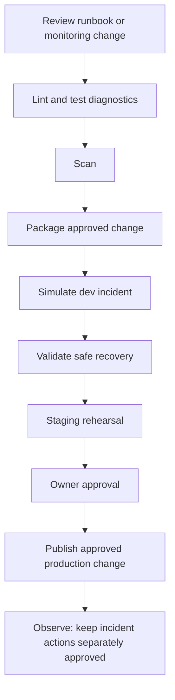
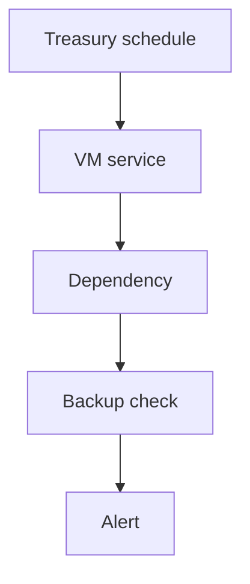

# P45 Banking Treasury Application Platform Support

**Cloud:** Azure  
**Industry:** Banking  
**Project type:** Support  
**Resume occurrences:** 2

[Back to project index](README.md)

This guide preserves the extracted resume content and expands it into a proposed implementation flow. Confirm actual application and infrastructure details before using it as an execution runbook. Lab occurrences remain lab work.

## End to end objectives and CI/CD implementation

This is a complete reference delivery design for this title, including orchestration YAML, script contracts and project-specific execution. The actual application repository, credentials, resource names and infrastructure were not provided. The YAML will not deploy a real project until those values and the required project-owned scripts and Make targets are implemented and tested.

### A. Project objectives

- Business objective: Supported treasury application services through scheduled health checks, infrastructure troubleshooting and incident coordination.
- Technical objective: implement the specific path Treasury schedule > VM service > Dependency > Backup check > Alert using the resume stack: Azure VMs, Azure Monitor, Log Analytics, PowerShell, Azure Backup.
- Acceptance objective: Services and scheduled processing recover with confirmation.
- Recovery objective: detect storage pressure or stopped dependencies block processing and rehearse this response: Restore settings and reconcile interrupted work before rerunning.
- Delivery objective: version, test and promote monitoring, runbooks, recovery automation and configuration fixes; do not rebuild an unrelated application or automatically replay production business operations.

### B. Business flow and delivery flow

**Business or operational path:** Treasury schedule > VM service > Dependency > Backup check > Alert.




The pipeline transports **Reviewed monitoring rules, diagnostic checks, runbook changes and bounded recovery code**. Source review, build/test signals and deployment identity are separate controls. One CI bundle is promoted through all environments; production does not fetch a new branch head. For container deployments, build and scan the image in CI, record its digest in the payload manifest and reuse that digest instead of rebuilding it per environment.

### C. Repository layout


```text
projects/P45/                  # application, runbook or migration source
infra/P45/                     # reviewed resource definitions and provider locks
environments/dev/                # non-secret dev configuration
environments/staging/            # non-secret staging configuration
environments/prod/               # non-secret prod configuration
scripts/P45/ci.sh
scripts/P45/verify-release.sh
scripts/P45/preflight.sh
scripts/P45/plan.sh
scripts/P45/execute.sh
scripts/P45/verify.sh
scripts/P45/rollback.sh
tests/P45/                     # unit, integration, negative and recovery tests
pipelines/P45/                 # pipeline YAML and buildspec files
Makefile                         # validate, test, scan and package targets
release/                         # generated artifacts; never commit credentials
```

### D. Environment and access preparation

1. Create the Azure DevOps repository, protected main branch and PR validation build policy. The example uses `pr: none`; Azure Repos PR validation is configured through branch policy. For other repository providers, configure the supported PR trigger explicitly.
2. Create the `P45-delivery-config` variable group with dev/staging/prod service-connection names and resource-group names. Store secrets through protected secret references; do not place them in ordinary YAML values.
3. Configure three scoped service connections, preferably using supported workload identity federation. Use separate identities and subscription/resource boundaries according to the environment design.
4. Pre-create `P45-dev`, `P45-staging` and `P45-prod` environments. Configure the required approvals/checks and exclusive production change control on the resources outside the YAML. Restrict pipeline permission to those resources.
5. Provision network access and tool versions. The hosted Linux agent is an example; use an isolated private agent when targets or dependencies require private connectivity. Pin the actual supported Terraform, Helm, kubectl, language and scanner versions in your agent setup.
6. Implement and validate the script contract below. Pipeline success must reflect real assertions rather than a script that merely prints a completed message.

### E. Azure Pipelines YAML

Save as `pipelines/P45/azure-pipelines.yml`. The production environment approval is an external prerequisite; the YAML alone does not install an approval rule.


```yaml
name: P45-$(Date:yyyyMMdd).$(Rev:r)
trigger:
  branches:
    include:
    - main
  paths:
    include:
    - projects/P45/**
    - infra/P45/**
    - scripts/P45/**
    - tests/P45/**
    - pipelines/P45/**
pr: none
pool:
  vmImage: ubuntu-latest
variables:
- group: P45-delivery-config
stages:
- stage: CI
  displayName: P45 — Banking Treasury Application Platform Support
  jobs:
  - job: ValidateAndPackage
    steps:
    - checkout: self
      clean: true
      persistCredentials: false
    - bash: bash scripts/P45/ci.sh
      displayName: 'P45: validate, test, scan and package'
      env:
        COMMIT_SHA: $(Build.SourceVersion)
        PROJECT_ID: P45
    - publish: $(Build.SourcesDirectory)/release
      artifact: P45-release
      displayName: Publish immutable release bundle
- stage: Dev
  dependsOn: CI
  condition: succeeded()
  displayName: Isolated rehearsal
  jobs:
  - deployment: P45_dev
    environment: P45-dev
    strategy:
      runOnce:
        deploy:
          steps:
          - download: none
          - download: current
            artifact: P45-release
          - task: AzureCLI@2
            displayName: 'P45 dev: operations'
            inputs:
              azureSubscription: $(devServiceConnection)
              scriptType: bash
              scriptLocation: inlineScript
              inlineScript: 'set -euo pipefail

                mkdir -p "$REPORT_DIR"

                mkdir -p "$PLAN_DIR"

                # Operate on the bundle produced by CI, not a fresh branch checkout.

                bash "$RELEASE_DIR/verify-release.sh" "$RELEASE_DIR"

                mkdir -p "$AGENT_TEMPDIRECTORY/P45-dev-src"

                tar -xzf "$RELEASE_DIR/source.tgz" -C "$AGENT_TEMPDIRECTORY/P45-dev-src"

                cd "$AGENT_TEMPDIRECTORY/P45-dev-src"

                bash scripts/P45/preflight.sh "$TARGET_ENV" "$RELEASE_DIR" "$REPORT_DIR"

                bash scripts/P45/plan.sh "$TARGET_ENV" "$RELEASE_DIR" "$REPORT_DIR"

                bash scripts/P45/execute.sh "$TARGET_ENV" "$RELEASE_DIR" "$REPORT_DIR"

                bash scripts/P45/verify.sh "$TARGET_ENV" "$RELEASE_DIR" "$REPORT_DIR"'
            env:
              PROJECT_ID: P45
              TARGET_ENV: dev
              CHANGE_MODE: operations
              RELEASE_DIR: $(Pipeline.Workspace)/P45-release
              REPORT_DIR: $(Agent.TempDirectory)/P45-dev-reports
              PLAN_DIR: $(Agent.TempDirectory)/P45-dev-restricted
              RESOURCE_GROUP: $(devResourceGroup)
          - task: PublishPipelineArtifact@1
            condition: always()
            displayName: Publish sanitized stage evidence
            inputs:
              targetPath: $(Agent.TempDirectory)/P45-dev-reports
              artifact: P45-dev-evidence
- stage: Staging
  dependsOn: Dev
  condition: succeeded()
  displayName: Representative validation
  jobs:
  - deployment: P45_staging
    environment: P45-staging
    strategy:
      runOnce:
        deploy:
          steps:
          - download: none
          - download: current
            artifact: P45-release
          - task: AzureCLI@2
            displayName: 'P45 staging: operations'
            inputs:
              azureSubscription: $(stagingServiceConnection)
              scriptType: bash
              scriptLocation: inlineScript
              inlineScript: 'set -euo pipefail

                mkdir -p "$REPORT_DIR"

                mkdir -p "$PLAN_DIR"

                # Operate on the bundle produced by CI, not a fresh branch checkout.

                bash "$RELEASE_DIR/verify-release.sh" "$RELEASE_DIR"

                mkdir -p "$AGENT_TEMPDIRECTORY/P45-staging-src"

                tar -xzf "$RELEASE_DIR/source.tgz" -C "$AGENT_TEMPDIRECTORY/P45-staging-src"

                cd "$AGENT_TEMPDIRECTORY/P45-staging-src"

                bash scripts/P45/preflight.sh "$TARGET_ENV" "$RELEASE_DIR" "$REPORT_DIR"

                bash scripts/P45/plan.sh "$TARGET_ENV" "$RELEASE_DIR" "$REPORT_DIR"

                bash scripts/P45/execute.sh "$TARGET_ENV" "$RELEASE_DIR" "$REPORT_DIR"

                bash scripts/P45/verify.sh "$TARGET_ENV" "$RELEASE_DIR" "$REPORT_DIR"'
            env:
              PROJECT_ID: P45
              TARGET_ENV: staging
              CHANGE_MODE: operations
              RELEASE_DIR: $(Pipeline.Workspace)/P45-release
              REPORT_DIR: $(Agent.TempDirectory)/P45-staging-reports
              PLAN_DIR: $(Agent.TempDirectory)/P45-staging-restricted
              RESOURCE_GROUP: $(stagingResourceGroup)
          - task: PublishPipelineArtifact@1
            condition: always()
            displayName: Publish sanitized stage evidence
            inputs:
              targetPath: $(Agent.TempDirectory)/P45-staging-reports
              artifact: P45-staging-evidence
- stage: Prod
  dependsOn: Staging
  condition: succeeded()
  displayName: Approved production change
  jobs:
  - deployment: P45_prod
    environment: P45-prod
    strategy:
      runOnce:
        deploy:
          steps:
          - download: none
          - download: current
            artifact: P45-release
          - task: AzureCLI@2
            displayName: 'P45 prod: operations'
            inputs:
              azureSubscription: $(prodServiceConnection)
              scriptType: bash
              scriptLocation: inlineScript
              inlineScript: 'set -euo pipefail

                mkdir -p "$REPORT_DIR"

                mkdir -p "$PLAN_DIR"

                # Operate on the bundle produced by CI, not a fresh branch checkout.

                bash "$RELEASE_DIR/verify-release.sh" "$RELEASE_DIR"

                mkdir -p "$AGENT_TEMPDIRECTORY/P45-prod-src"

                tar -xzf "$RELEASE_DIR/source.tgz" -C "$AGENT_TEMPDIRECTORY/P45-prod-src"

                cd "$AGENT_TEMPDIRECTORY/P45-prod-src"

                bash scripts/P45/preflight.sh "$TARGET_ENV" "$RELEASE_DIR" "$REPORT_DIR"

                bash scripts/P45/plan.sh "$TARGET_ENV" "$RELEASE_DIR" "$REPORT_DIR"

                bash scripts/P45/execute.sh "$TARGET_ENV" "$RELEASE_DIR" "$REPORT_DIR"

                bash scripts/P45/verify.sh "$TARGET_ENV" "$RELEASE_DIR" "$REPORT_DIR"'
            env:
              PROJECT_ID: P45
              TARGET_ENV: prod
              CHANGE_MODE: operations
              RELEASE_DIR: $(Pipeline.Workspace)/P45-release
              REPORT_DIR: $(Agent.TempDirectory)/P45-prod-reports
              PLAN_DIR: $(Agent.TempDirectory)/P45-prod-restricted
              RESOURCE_GROUP: $(prodResourceGroup)
          - task: PublishPipelineArtifact@1
            condition: always()
            displayName: Publish sanitized stage evidence
            inputs:
              targetPath: $(Agent.TempDirectory)/P45-prod-reports
              artifact: P45-prod-evidence
```

### F. CI packaging and immutable promotion

Save this wrapper as `scripts/P45/ci.sh`. Its Make targets are application/project-owned integration points, not included application source. Implement them according to the contract below. Payloads must contain the selected deployment unit and relevant test reports; avoid sensitive data and unencrypted Terraform state or plans.


```bash
#!/usr/bin/env bash
set -euo pipefail
: "${PROJECT_ID:?Set PROJECT_ID}"
: "${COMMIT_SHA:?Set COMMIT_SHA}"
# Required project-owned targets; implement these against the selected language and tools.
make validate PROJECT_ID="$PROJECT_ID"
make test PROJECT_ID="$PROJECT_ID"
make scan PROJECT_ID="$PROJECT_ID"
mkdir -p release/payload
make package PROJECT_ID="$PROJECT_ID" OUTPUT_DIR="$PWD/release/payload"
# CI source artifacts may be extracted ZIPs with no .git directory.
tar --exclude='./release' --exclude='./reports' --exclude='./.git' -czf release/source.tgz .
printf '%s\n' "$COMMIT_SHA" > release/source-revision.txt
printf '%s\n' "$PROJECT_ID" > release/project-id.txt
# A digest detects accidental changes; bucket/artifact access controls provide trust.
(cd release && find payload -type f -print0 | sort -z | xargs -0 -r sha256sum; sha256sum source.tgz source-revision.txt project-id.txt) > release/SHA256SUMS
cp "scripts/$PROJECT_ID/verify-release.sh" release/verify-release.sh
```

Save this verifier as `scripts/P45/verify-release.sh`.


```bash
#!/usr/bin/env bash
set -euo pipefail
bundle="${1:?Release directory required}"
cd "$bundle"
test -s source-revision.txt
test -s project-id.txt
test -f source.tgz
# Reject archive paths that could escape the isolated extraction directory.
if tar -tzf source.tgz | grep -Eq '(^/|(^|/)\.\.(/|$))'; then
  echo "Unsafe source archive path" >&2
  exit 1
fi
sha256sum -c SHA256SUMS
```

### G. Required script and artifact contracts

All scripts use `set -euo pipefail`, reject missing required values, avoid shell tracing of secrets and exit nonzero on a failed assertion. Stage hooks take three arguments: environment, release directory and report directory. They must put sanitized evidence into the report directory and keep sensitive plans/state in a separately restricted store.

| File or target | Project-specific implementation | Required behavior |
| --- | --- | --- |
| make validate | Lint diagnostic and recovery scripts; validate alert and runbook configuration | Exit nonzero on invalid inputs, missing schemas or invalid environment configuration. |
| make test | Run unit and contract tests plus safe fixtures for Banking Treasury Application Platform Support | Produce results without contacting production systems. |
| make scan | Run pinned secret, dependency and infrastructure scans relevant to the selected stack | Fail on the project-approved blocking rules and store sanitized results. |
| make package | Reviewed monitoring rules, diagnostic checks, runbook changes and bounded recovery code | Write versioned deliverables under OUTPUT_DIR; do not put secrets or sensitive inventories in the bundle. |
| preflight.sh | Verify target account/subscription, region, identity, required variables and rollback availability | Record the target and stop on mismatch. Assert CHANGE_MODE and TARGET_ENV before mutation. |
| plan.sh | Capture incident or change impact and a bounded remediation plan | Save sanitized plan and stop conditions to REPORT_DIR; plan is not permission to perform destructive work. |
| execute.sh | Identify affected services, schedules and recent changes; Inspect operating-system logs, storage and dependencies; Approve maintenance or service recovery with owners; Verify access, processing and backup-job status | In dev/staging use isolated targets. In prod perform only the approved change; keep retirement, destructive cleanup and incident replay separately authorized. |
| verify.sh | Services and scheduled processing recover with confirmation | Test complete user paths and negative cases; exit nonzero on failure and record safe evidence. |
| rollback.sh | Restore settings and reconcile interrupted work before rerunning | Require a selected accepted release and reconciliation decision; validate target identity and capture recovery results. Never silently auto-rollback data. |
| verify-release.sh | Validate immutable bundle paths and SHA256SUMS before extraction | Digest checks do not substitute for restricted artifact-store permissions. |

### H. Title-specific execution sequence

1. **Identify affected services, schedules and recent changes.** Record the relevant resource or revision, the validation result and the accepted next state before continuing. In production, use the scope accepted by the named owner; the pipeline must not broaden its own authority.
2. **Inspect operating-system logs, storage and dependencies.** Record the relevant resource or revision, the validation result and the accepted next state before continuing. In production, use the scope accepted by the named owner; the pipeline must not broaden its own authority.
3. **Approve maintenance or service recovery with owners.** Record the relevant resource or revision, the validation result and the accepted next state before continuing. In production, use the scope accepted by the named owner; the pipeline must not broaden its own authority.
4. **Verify access, processing and backup-job status.** Record the relevant resource or revision, the validation result and the accepted next state before continuing. In production, use the scope accepted by the named owner; the pipeline must not broaden its own authority.

The following fragment illustrates the platform boundary for this project; fill its required variables from validated non-secret environment configuration and secure references. It is a fragment to integrate into the hooks, not a replacement for the full preflight, approval and verification flow.


```bash
# First confirm the intended diagnostic target.
az account show --query "{subscription:id,tenant:tenantId}" -o json
# Diagnostic findings must be sanitized; no customer document or secret values.
# 1. Identify affected services, schedules and recent changes
# 2. Inspect operating-system logs, storage and dependencies
# 3. Approve maintenance or service recovery with owners
# 4. Verify access, processing and backup-job status
# Production runbook deployment and incident remediation are separate approvals.
# Restart, replay, rerun or traffic changes require the incident-specific scope.
```

### I. Dev to staging to production walkthrough

| Stage | End to end behavior |
| --- | --- |
| Source review | A developer changes the source/configuration relevant to this title, links the work item and obtains required protected-branch review. CI validation is required before merge. |
| CI validation | Run the project-specific Make targets, test fixtures and blocking security rules. Failed scans or tests stop the release before any production credentials are used. |
| Package | Produce Reviewed monitoring rules, diagnostic checks, runbook changes and bounded recovery code. Record the commit and file digests. Preserve immutable registry/package identifiers if an external registry is involved. |
| Dev | Validate account/subscription and run preflight, plan, execute and verify against isolated resources. Identify affected services, schedules and recent changes. |
| Staging | Use representative isolated dependencies and rehearse the complete path, including storage pressure or stopped dependencies block processing. Capture rollback and reconciliation results. |
| Approval | An owner reviews the source revision, artifact identity, staging tests, target impact, recovery readiness and any data reconciliation. Reject stale plans or unresolved business-state uncertainty. |
| Production | Recheck the real target and allowed scope, then promote the exact bundle. Verify access, processing and backup-job status. Stop on failed assertions. |
| Verification | Acceptance is: Services and scheduled processing recover with confirmation. Technical deployment success without application-path tests is insufficient. |
| Recovery | On failure, stop further changes and preserve evidence. Restore settings and reconcile interrupted work before rerunning. A separate controlled rollback uses rollback.sh and the previously accepted compatible release; the sample pipeline deliberately does not invoke an indiscriminate automatic rollback. |
| Handover | Publish sanitized execution results and named monitoring ownership. Keep source retirement, destructive cleanup, backlog replay and retention decisions separate from deployment completion. |

### J. Production stop conditions and acceptance

- Stop if the account/subscription, environment, approved revision or identity differs from the change record.
- Stop if any required test, signature/digest check, access review or plan comparison fails.
- Stop if business state is uncertain; resolve duplicate writes, files, messages or jobs with the application/data owner before retry or failback.
- Stop if storage pressure or stopped dependencies block processing.
- Accept only when services and scheduled processing recover with confirmation and the owner accepts monitoring and recovery readiness.
- Do not use fabricated latency, availability, transaction-volume or savings claims. Choose actual thresholds and observation windows with the owner.

### K. Platform reference documentation

- [Azure deployment environments](https://learn.microsoft.com/azure/devops/pipelines/process/environments)
- [Azure resource approvals and checks](https://learn.microsoft.com/en-us/azure/devops/pipelines/process/approvals?view=azure-devops)

## Detailed application, operations and recovery flow

The original complete project flow follows, including the extracted resume description, architecture, ten execution stages, tests, monitoring, incident response, security and resume references.

## Extracted resume content

**Extracted from the resumes**

Supported treasury application services through scheduled health checks, infrastructure troubleshooting and incident coordination.

Skills used: Azure VMs, Azure Monitor, Log Analytics, PowerShell, Azure Backup

- Investigated application outages using operating-system logs, service status and dependency checks.
- Maintained alerts for storage pressure, unavailable services and scheduled-processing failures.
- Coordinated approved service recovery and validated access after infrastructure maintenance.
- Documented escalation paths and confirmed backup-job health as part of routine support checks.
- Checked incident impact, recent changes and dependency health before selecting documented recovery steps.
- Recorded investigation notes, escalation details and follow-up actions in the service support knowledge base.

## 1. Purpose and implementation boundary

This support flow concerns Banking Treasury Application Platform Support. Proposed acceptance condition: Services and scheduled processing recover with confirmation. The detailed sequence below is a planning and learning expansion of the resume, not proof that these steps were performed in a client environment.

Confirm application language, repository URL, exact resource names, account or subscription structure, regions, versions, client identity, traffic volumes, SLOs, data-retention requirements and approval owners. These are not supplied in the resumes and are not invented here.

## 2. Architecture and main flow



**Flow:** Treasury schedule → VM service → Dependency → Backup check → Alert

The boxes show logical boundaries, not a verified deployed topology. Keep build or change identity separate from runtime identity; carry a release, incident or migration identifier across logs and handover records.

**Decision gate**

All stage checks pass? Continue to the next stage. A check fails? Stop promotion or traffic movement, preserve diagnostics and assess recovery. A business side effect may already exist? Reconcile it with the application owner before replay, rerun or failback.

## 3. Prerequisites and ownership

| Owner | Required input | Completion responsibility |
| --- | --- | --- |
| Application owner | Expected user journeys, dependencies, data contract and test examples | Accept functional behavior and reconcile business state |
| DevOps engineer | Source revision, resource inventory, pipeline access and tool configuration | Implement reviewed changes and capture validation results |
| Platform and identity owner | Network paths, deployment identity, runtime roles and approved secret references | Approve scoped access and environment readiness |
| QA or lab reviewer | Controlled fixtures and acceptance cases | Verify normal, negative and recovery behavior |
| Operations or incident owner | Baseline signals, alert routing and recovery contacts | Own monitoring, incident escalation and handover |
| Data owner when applicable | Authoritative copy, writer controls and reconciliation method | Approve synchronization, replay, data recovery and retention |

## 4. Detailed execution flow

### 1. Receive and scope the incident

**Owner:** Support engineer and incident owner

Input: Alert, ticket or failed synthetic request

Action: Record the affected service, environment, start time, user impact and severity. Link the request to Banking Treasury Application Platform Support and identify the responsible application owner.

Output and gate: Incident record with scope and ownership

If the gate fails: Escalate unknown ownership or broad impact before making changes.

### 2. Preserve context and correlate signals

**Owner:** Support engineer

Input: Recent releases, sanitized logs and resource state

Action: Capture relevant request identifiers, deployment versions, timestamps and health checks before restarting anything. Confirm timezone and environment when comparing signals.

Output and gate: A bounded timeline and failure hypothesis

If the gate fails: If signals conflict, gather targeted telemetry instead of making multiple speculative changes.

### 3. Set safe recovery boundaries

**Owner:** Incident owner and application owner

Input: Impact assessment and available recovery paths

Action: Agree permitted actions, change approval, data reconciliation and rollback ownership. For payment, invoice or settlement state, explicitly identify potentially completed side effects.

Output and gate: Approved recovery scope and test plan

If the gate fails: Hold replay or rerun actions when business state is uncertain.

### 4. Execute project stage 1

**Owner:** DevOps engineer with incident owner

Input: Accepted output of the preceding stage and relevant resume tools

Action: Identify affected services, schedules and recent changes. Validate the result before moving to the next boundary in the architecture flow.

Output and gate: Stage record identifying the exact resource or revision, check performed and result

If the gate fails: On failure, stop progression and inspect storage pressure or stopped dependencies block processing. Retain the last accepted state.

### 5. Execute project stage 2

**Owner:** DevOps engineer with incident owner

Input: Accepted output of the preceding stage and relevant resume tools

Action: Inspect operating-system logs, storage and dependencies. Validate the result before moving to the next boundary in the architecture flow.

Output and gate: Stage record identifying the exact resource or revision, check performed and result

If the gate fails: On failure, stop progression and inspect storage pressure or stopped dependencies block processing. Retain the last accepted state.

### 6. Execute project stage 3

**Owner:** DevOps engineer with incident owner

Input: Accepted output of the preceding stage and relevant resume tools

Action: Approve maintenance or service recovery with owners. Validate the result before moving to the next boundary in the architecture flow.

Output and gate: Stage record identifying the exact resource or revision, check performed and result

If the gate fails: On failure, stop progression and inspect storage pressure or stopped dependencies block processing. Retain the last accepted state.

### 7. Execute project stage 4

**Owner:** DevOps engineer with incident owner

Input: Accepted output of the preceding stage and relevant resume tools

Action: Verify access, processing and backup-job status. Validate the result before moving to the next boundary in the architecture flow.

Output and gate: Stage record identifying the exact resource or revision, check performed and result

If the gate fails: On failure, stop progression and inspect storage pressure or stopped dependencies block processing. Retain the last accepted state.

### 8. Validate the complete application path

**Owner:** QA and application owner

Input: Completed technical steps and controlled fixtures

Action: Exercise the complete path through Dependency to Backup check to Alert. Check a normal request, an access-denied case and a failed dependency. Reconcile any partial writes or repeated events.

Output and gate: Services and scheduled processing recover with confirmation.

If the gate fails: If any acceptance check fails, keep the change unaccepted and use the recovery decision below.

### 9. Approve completion and observe stability

**Owner:** Change or incident owner

Input: Functional results and monitoring baseline

Action: Confirm that expected Azure logs, resource health and application signals are visible. Compare with the accepted baseline for an owner-agreed observation period; do not invent numerical SLOs or durations.

Output and gate: Owner sign-off, observation record and resolved exceptions

If the gate fails: Reopen the incident or stop the cutover when regression exceeds agreed limits.

### 10. Hand over and close

**Owner:** DevOps and operations owner

Input: Accepted service state and open follow-up actions

Action: Publish the runbook, version or configuration references, recovery procedure, alert ownership and known limitations. For migrations, defer source retirement until retention and reconciliation are signed off.

Output and gate: Operational handover and tracked follow-up work

If the gate fails: Leave risky cleanup or retirement pending rather than treating technical completion as automatic approval.

## 5. Project-specific integration checks

| Boundary | Required checks |
| --- | --- |
| Recovery preservation | Confirm supported vault and protection transitions and retain required recovery points. A successful new backup does not prove older retention obligations or restoration capability. |

## 6. Validation matrix

| Test | Execution | Acceptance |
| --- | --- | --- |
| Normal flow | Run one controlled example across the complete architecture path | Services and scheduled processing recover with confirmation |
| Denied access | Use a test identity without the required role | Access is denied, sanitized diagnostics are available and no permissions are broadened |
| Project failure | Rehearse this failure in isolation: Storage pressure or stopped dependencies block processing | The failure is detected and the runbook identifies a bounded response |
| Unavailable dependency | Use a controlled dependency failure or safely simulated unavailable endpoint | Errors remain visible and the recovery path does not create uncontrolled retries |
| Repeated execution | Repeat the test or stage only in an isolated environment with a known initial state | State changes are reconciled; repeated execution does not silently duplicate a business operation |
| Recovery rehearsal | Practice the proposed recovery with compatible revisions and controlled state | Restore settings and reconcile interrupted work before rerunning |
| Configuration isolation | Check target environment, identifiers and non-sensitive settings | No environment points accidentally to another environment or unauthorized endpoint |
| Operational readiness | Review logs, alerts, runbook, resource owner and follow-up ticket | An operator can detect the failure, identify the changed revision and invoke the approved recovery |

## 7. Monitoring and incident response

Use Azure Monitor, Log Analytics or Application Insights, as listed in the source. Enable only telemetry appropriate to the resources actually selected. Connect alert rules to named owners and choose thresholds from an agreed baseline rather than treating example numbers as production requirements.

| Signal | What to inspect | Response |
| --- | --- | --- |
| Application behavior | Synthetic request results, correctness and dependency errors | Correlate with the release or incident identifier and test the affected boundary |
| Project-specific symptom | Storage pressure or stopped dependencies block processing | Pause further changes and isolate identity, configuration, runtime or data causes |
| Resource health | Availability, restarts, capacity and relevant service health | Compare with the baseline; approve bounded recovery before scaling or restarting |
| Identity or network denial | Sanitized authorization failures, DNS or routing errors | Check the intended identity and network path; avoid wildcard grants |
| Delivery or migration progress | Stage status, active revisions, remaining work and reconciled state | Stop progression on incomplete validation or unexplained divergence |
| Repeated failures | Recurrence, attempted recovery and known limitations | Escalate with a clear timeline and preserve failed-state diagnostics |

## 8. Rollback and recovery runbook

1. Declare the failed acceptance condition and stop new promotions, unsafe replays or further traffic changes. Keep one named incident or cutover owner.
2. Capture the current revision, relevant resource state, timestamps and sanitized errors. Preserve the previous accepted configuration and any required state backup.
3. Identify partially completed requests, messages, files, jobs or writes. Agree the authoritative state and writer before starting recovery.
4. Project recovery action: Restore settings and reconcile interrupted work before rerunning.
5. Verify configuration, credential validity, schema and data compatibility. A compromised credential or an incompatible database schema must not be restored blindly.
6. Run the same complete-path normal and negative tests used for acceptance. Confirm both application behavior and resource health.
7. Observe for the agreed period and reconcile pending or repeated work. Retain source or prior revisions until recovery is accepted.
8. Document the failed gate, action, operator, recovered revision, outstanding risks and follow-up owner. Resume delivery only after the owner approves the new plan.

## 9. Security and operating controls

- Scope deployment and runtime identities separately. Prefer the approved non-interactive identity mechanism for the chosen stack and review service-to-service permissions.
- Keep credentials out of source, pipeline output, screenshots, tickets and flow documents. Use the approved secret store or protected reference supported by the selected architecture.
- Review private paths, ingress rules and allowed endpoints. A connectivity error is a reason to inspect the path, not to disable access controls.
- Use synthetic banking and retail test records. Sanitize logs and obtain application-owner approval before accessing sensitive data.
- Record the source revision, artifact or configuration version, approval and target environment. Retain change and incident history under the organization policy.

## 10. Deliverables and handover checklist

- Scoped architecture and dependency inventory for Banking Treasury Application Platform Support.
- Reviewed source, infrastructure or configuration references using the listed tools: Azure VMs, Azure Monitor, Log Analytics, PowerShell, Azure Backup.
- Environment and identity mapping with secret references, excluding secret values.
- Execution checklist with stage outputs, stop conditions and named owners.
- Completed validation matrix, controlled test examples and unresolved exceptions.
- Rollback rehearsal and data or message reconciliation instructions when applicable.
- Monitoring configuration, alert routing, operating runbook and escalation contacts.
- Final owner acceptance and a follow-up list for source retirement, retention, cleanup or improvements.

## 11. Walkthrough for study or discussion

Explain the objective first: Supported treasury application services through scheduled health checks, infrastructure troubleshooting and incident coordination. Then walk through Treasury schedule → VM service → Dependency → Backup check → Alert. Describe the four project-specific execution stages, how storage pressure or stopped dependencies block processing would be detected, and why the recovery action is restore settings and reconcile interrupted work before rerunning. Finish with the acceptance tests and operating handover. Describe only work actually performed; keep proposed steps and labs labeled accordingly.

## 12. Resume references

| Student | Cloud resume | Project number | Resume title | Context |
| --- | --- | --- | --- | --- |
| Mahesh | Azure | 2 | Banking Treasury Application Platform Support | Resume draft |
| Chandhu G | Azure | 2 | Banking Treasury Application Platform Support | Resume draft |
