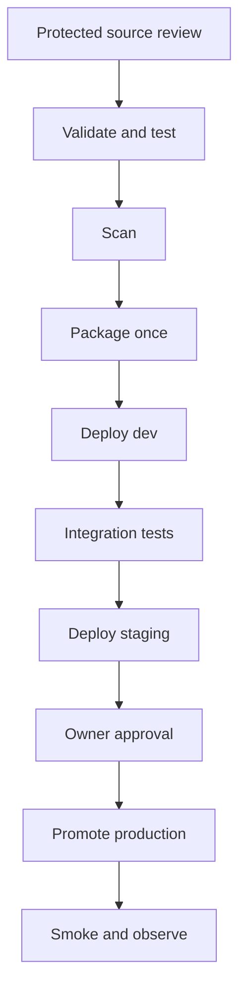
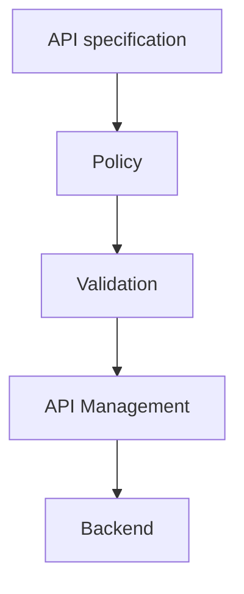

# P51 Retail API Management Deployment Framework

**Cloud:** Azure  
**Industry:** Retail  
**Project type:** Development  
**Resume occurrences:** 1

[Back to project index](README.md)

This guide preserves the extracted resume content and expands it into a proposed implementation flow. Confirm actual application and infrastructure details before using it as an execution runbook. Lab occurrences remain lab work.

## End to end objectives and CI/CD implementation

This is a complete reference delivery design for this title, including orchestration YAML, script contracts and project-specific execution. The actual application repository, credentials, resource names and infrastructure were not provided. The YAML will not deploy a real project until those values and the required project-owned scripts and Make targets are implemented and tested.

### A. Project objectives

- Business objective: Built delivery workflows for retail API gateway definitions and reviewed policies across isolated Azure environments.
- Technical objective: implement the specific path API specification > Policy > Validation > API Management > Backend using the resume stack: Azure API Management, Azure Pipelines, OpenAPI, Terraform, Git, PowerShell.
- Acceptance objective: Routes and access rules behave as approved.
- Recovery objective: detect broken policy or backend reference changes routing and rehearse this response: Restore the prior API revision and compatible policy.
- Delivery objective: test and package one approved revision, validate it in isolated environments and promote the same release bundle through controlled production delivery.

### B. Business flow and delivery flow

**Business or operational path:** API specification > Policy > Validation > API Management > Backend.




The pipeline transports **Reviewed infrastructure, policy, agent, API, signing or feature configuration for this title**. Source review, build/test signals and deployment identity are separate controls. One CI bundle is promoted through all environments; production does not fetch a new branch head. For container deployments, build and scan the image in CI, record its digest in the payload manifest and reuse that digest instead of rebuilding it per environment.

### C. Repository layout


```text
projects/P51/                  # application, runbook or migration source
infra/P51/                     # reviewed resource definitions and provider locks
environments/dev/                # non-secret dev configuration
environments/staging/            # non-secret staging configuration
environments/prod/               # non-secret prod configuration
scripts/P51/ci.sh
scripts/P51/verify-release.sh
scripts/P51/preflight.sh
scripts/P51/plan.sh
scripts/P51/execute.sh
scripts/P51/verify.sh
scripts/P51/rollback.sh
tests/P51/                     # unit, integration, negative and recovery tests
pipelines/P51/                 # pipeline YAML and buildspec files
Makefile                         # validate, test, scan and package targets
release/                         # generated artifacts; never commit credentials
```

### D. Environment and access preparation

1. Create the Azure DevOps repository, protected main branch and PR validation build policy. The example uses `pr: none`; Azure Repos PR validation is configured through branch policy. For other repository providers, configure the supported PR trigger explicitly.
2. Create the `P51-delivery-config` variable group with dev/staging/prod service-connection names and resource-group names. Store secrets through protected secret references; do not place them in ordinary YAML values.
3. Configure three scoped service connections, preferably using supported workload identity federation. Use separate identities and subscription/resource boundaries according to the environment design.
4. Pre-create `P51-dev`, `P51-staging` and `P51-prod` environments. Configure the required approvals/checks and exclusive production change control on the resources outside the YAML. Restrict pipeline permission to those resources.
5. Provision network access and tool versions. The hosted Linux agent is an example; use an isolated private agent when targets or dependencies require private connectivity. Pin the actual supported Terraform, Helm, kubectl, language and scanner versions in your agent setup.
6. Implement and validate the script contract below. Pipeline success must reflect real assertions rather than a script that merely prints a completed message.

### E. Azure Pipelines YAML

Save as `pipelines/P51/azure-pipelines.yml`. The production environment approval is an external prerequisite; the YAML alone does not install an approval rule.


```yaml
name: P51-$(Date:yyyyMMdd).$(Rev:r)
trigger:
  branches:
    include:
    - main
  paths:
    include:
    - projects/P51/**
    - infra/P51/**
    - scripts/P51/**
    - tests/P51/**
    - pipelines/P51/**
pr: none
pool:
  vmImage: ubuntu-latest
variables:
- group: P51-delivery-config
stages:
- stage: CI
  displayName: P51 — Retail API Management Deployment Framework
  jobs:
  - job: ValidateAndPackage
    steps:
    - checkout: self
      clean: true
      persistCredentials: false
    - bash: bash scripts/P51/ci.sh
      displayName: 'P51: validate, test, scan and package'
      env:
        COMMIT_SHA: $(Build.SourceVersion)
        PROJECT_ID: P51
    - publish: $(Build.SourcesDirectory)/release
      artifact: P51-release
      displayName: Publish immutable release bundle
- stage: Dev
  dependsOn: CI
  condition: succeeded()
  displayName: Isolated rehearsal
  jobs:
  - deployment: P51_dev
    environment: P51-dev
    strategy:
      runOnce:
        deploy:
          steps:
          - download: none
          - download: current
            artifact: P51-release
          - task: AzureCLI@2
            displayName: 'P51 dev: delivery'
            inputs:
              azureSubscription: $(devServiceConnection)
              scriptType: bash
              scriptLocation: inlineScript
              inlineScript: 'set -euo pipefail

                mkdir -p "$REPORT_DIR"

                mkdir -p "$PLAN_DIR"

                # Operate on the bundle produced by CI, not a fresh branch checkout.

                bash "$RELEASE_DIR/verify-release.sh" "$RELEASE_DIR"

                mkdir -p "$AGENT_TEMPDIRECTORY/P51-dev-src"

                tar -xzf "$RELEASE_DIR/source.tgz" -C "$AGENT_TEMPDIRECTORY/P51-dev-src"

                cd "$AGENT_TEMPDIRECTORY/P51-dev-src"

                bash scripts/P51/preflight.sh "$TARGET_ENV" "$RELEASE_DIR" "$REPORT_DIR"

                bash scripts/P51/plan.sh "$TARGET_ENV" "$RELEASE_DIR" "$REPORT_DIR"

                bash scripts/P51/execute.sh "$TARGET_ENV" "$RELEASE_DIR" "$REPORT_DIR"

                bash scripts/P51/verify.sh "$TARGET_ENV" "$RELEASE_DIR" "$REPORT_DIR"'
            env:
              PROJECT_ID: P51
              TARGET_ENV: dev
              CHANGE_MODE: delivery
              RELEASE_DIR: $(Pipeline.Workspace)/P51-release
              REPORT_DIR: $(Agent.TempDirectory)/P51-dev-reports
              PLAN_DIR: $(Agent.TempDirectory)/P51-dev-restricted
              RESOURCE_GROUP: $(devResourceGroup)
          - task: PublishPipelineArtifact@1
            condition: always()
            displayName: Publish sanitized stage evidence
            inputs:
              targetPath: $(Agent.TempDirectory)/P51-dev-reports
              artifact: P51-dev-evidence
- stage: Staging
  dependsOn: Dev
  condition: succeeded()
  displayName: Representative validation
  jobs:
  - deployment: P51_staging
    environment: P51-staging
    strategy:
      runOnce:
        deploy:
          steps:
          - download: none
          - download: current
            artifact: P51-release
          - task: AzureCLI@2
            displayName: 'P51 staging: delivery'
            inputs:
              azureSubscription: $(stagingServiceConnection)
              scriptType: bash
              scriptLocation: inlineScript
              inlineScript: 'set -euo pipefail

                mkdir -p "$REPORT_DIR"

                mkdir -p "$PLAN_DIR"

                # Operate on the bundle produced by CI, not a fresh branch checkout.

                bash "$RELEASE_DIR/verify-release.sh" "$RELEASE_DIR"

                mkdir -p "$AGENT_TEMPDIRECTORY/P51-staging-src"

                tar -xzf "$RELEASE_DIR/source.tgz" -C "$AGENT_TEMPDIRECTORY/P51-staging-src"

                cd "$AGENT_TEMPDIRECTORY/P51-staging-src"

                bash scripts/P51/preflight.sh "$TARGET_ENV" "$RELEASE_DIR" "$REPORT_DIR"

                bash scripts/P51/plan.sh "$TARGET_ENV" "$RELEASE_DIR" "$REPORT_DIR"

                bash scripts/P51/execute.sh "$TARGET_ENV" "$RELEASE_DIR" "$REPORT_DIR"

                bash scripts/P51/verify.sh "$TARGET_ENV" "$RELEASE_DIR" "$REPORT_DIR"'
            env:
              PROJECT_ID: P51
              TARGET_ENV: staging
              CHANGE_MODE: delivery
              RELEASE_DIR: $(Pipeline.Workspace)/P51-release
              REPORT_DIR: $(Agent.TempDirectory)/P51-staging-reports
              PLAN_DIR: $(Agent.TempDirectory)/P51-staging-restricted
              RESOURCE_GROUP: $(stagingResourceGroup)
          - task: PublishPipelineArtifact@1
            condition: always()
            displayName: Publish sanitized stage evidence
            inputs:
              targetPath: $(Agent.TempDirectory)/P51-staging-reports
              artifact: P51-staging-evidence
- stage: Prod
  dependsOn: Staging
  condition: succeeded()
  displayName: Approved production change
  jobs:
  - deployment: P51_prod
    environment: P51-prod
    strategy:
      runOnce:
        deploy:
          steps:
          - download: none
          - download: current
            artifact: P51-release
          - task: AzureCLI@2
            displayName: 'P51 prod: delivery'
            inputs:
              azureSubscription: $(prodServiceConnection)
              scriptType: bash
              scriptLocation: inlineScript
              inlineScript: 'set -euo pipefail

                mkdir -p "$REPORT_DIR"

                mkdir -p "$PLAN_DIR"

                # Operate on the bundle produced by CI, not a fresh branch checkout.

                bash "$RELEASE_DIR/verify-release.sh" "$RELEASE_DIR"

                mkdir -p "$AGENT_TEMPDIRECTORY/P51-prod-src"

                tar -xzf "$RELEASE_DIR/source.tgz" -C "$AGENT_TEMPDIRECTORY/P51-prod-src"

                cd "$AGENT_TEMPDIRECTORY/P51-prod-src"

                bash scripts/P51/preflight.sh "$TARGET_ENV" "$RELEASE_DIR" "$REPORT_DIR"

                bash scripts/P51/plan.sh "$TARGET_ENV" "$RELEASE_DIR" "$REPORT_DIR"

                bash scripts/P51/execute.sh "$TARGET_ENV" "$RELEASE_DIR" "$REPORT_DIR"

                bash scripts/P51/verify.sh "$TARGET_ENV" "$RELEASE_DIR" "$REPORT_DIR"'
            env:
              PROJECT_ID: P51
              TARGET_ENV: prod
              CHANGE_MODE: delivery
              RELEASE_DIR: $(Pipeline.Workspace)/P51-release
              REPORT_DIR: $(Agent.TempDirectory)/P51-prod-reports
              PLAN_DIR: $(Agent.TempDirectory)/P51-prod-restricted
              RESOURCE_GROUP: $(prodResourceGroup)
          - task: PublishPipelineArtifact@1
            condition: always()
            displayName: Publish sanitized stage evidence
            inputs:
              targetPath: $(Agent.TempDirectory)/P51-prod-reports
              artifact: P51-prod-evidence
```

### F. CI packaging and immutable promotion

Save this wrapper as `scripts/P51/ci.sh`. Its Make targets are application/project-owned integration points, not included application source. Implement them according to the contract below. Payloads must contain the selected deployment unit and relevant test reports; avoid sensitive data and unencrypted Terraform state or plans.


```bash
#!/usr/bin/env bash
set -euo pipefail
: "${PROJECT_ID:?Set PROJECT_ID}"
: "${COMMIT_SHA:?Set COMMIT_SHA}"
# Required project-owned targets; implement these against the selected language and tools.
make validate PROJECT_ID="$PROJECT_ID"
make test PROJECT_ID="$PROJECT_ID"
make scan PROJECT_ID="$PROJECT_ID"
mkdir -p release/payload
make package PROJECT_ID="$PROJECT_ID" OUTPUT_DIR="$PWD/release/payload"
# CI source artifacts may be extracted ZIPs with no .git directory.
tar --exclude='./release' --exclude='./reports' --exclude='./.git' -czf release/source.tgz .
printf '%s\n' "$COMMIT_SHA" > release/source-revision.txt
printf '%s\n' "$PROJECT_ID" > release/project-id.txt
# A digest detects accidental changes; bucket/artifact access controls provide trust.
(cd release && find payload -type f -print0 | sort -z | xargs -0 -r sha256sum; sha256sum source.tgz source-revision.txt project-id.txt) > release/SHA256SUMS
cp "scripts/$PROJECT_ID/verify-release.sh" release/verify-release.sh
```

Save this verifier as `scripts/P51/verify-release.sh`.


```bash
#!/usr/bin/env bash
set -euo pipefail
bundle="${1:?Release directory required}"
cd "$bundle"
test -s source-revision.txt
test -s project-id.txt
test -f source.tgz
# Reject archive paths that could escape the isolated extraction directory.
if tar -tzf source.tgz | grep -Eq '(^/|(^|/)\.\.(/|$))'; then
  echo "Unsafe source archive path" >&2
  exit 1
fi
sha256sum -c SHA256SUMS
```

### G. Required script and artifact contracts

All scripts use `set -euo pipefail`, reject missing required values, avoid shell tracing of secrets and exit nonzero on a failed assertion. Stage hooks take three arguments: environment, release directory and report directory. They must put sanitized evidence into the report directory and keep sensitive plans/state in a separately restricted store.

| File or target | Project-specific implementation | Required behavior |
| --- | --- | --- |
| make validate | Lint application, infrastructure and deployment definitions | Exit nonzero on invalid inputs, missing schemas or invalid environment configuration. |
| make test | Run unit and contract tests plus safe fixtures for Retail API Management Deployment Framework | Produce results without contacting production systems. |
| make scan | Run pinned secret, dependency and infrastructure scans relevant to the selected stack | Fail on the project-approved blocking rules and store sanitized results. |
| make package | Reviewed infrastructure, policy, agent, API, signing or feature configuration for this title | Write versioned deliverables under OUTPUT_DIR; do not put secrets or sensitive inventories in the bundle. |
| preflight.sh | Verify target account/subscription, region, identity, required variables and rollback availability | Record the target and stop on mismatch. Assert CHANGE_MODE and TARGET_ENV before mutation. |
| plan.sh | Generate the intended deployment or infrastructure change plan | Save sanitized plan and stop conditions to REPORT_DIR; plan is not permission to perform destructive work. |
| execute.sh | Version routes, definitions and environment policy parameters; Validate syntax and backend references; Test authentication and supported request paths in isolation; Promote the reviewed revision and monitor backend errors | In dev/staging use isolated targets. In prod perform only the approved change; keep retirement, destructive cleanup and incident replay separately authorized. |
| verify.sh | Routes and access rules behave as approved | Test complete user paths and negative cases; exit nonzero on failure and record safe evidence. |
| rollback.sh | Restore the prior API revision and compatible policy | Require a selected accepted release and reconciliation decision; validate target identity and capture recovery results. Never silently auto-rollback data. |
| verify-release.sh | Validate immutable bundle paths and SHA256SUMS before extraction | Digest checks do not substitute for restricted artifact-store permissions. |

### H. Title-specific execution sequence

1. **Version routes, definitions and environment policy parameters.** Record the relevant resource or revision, the validation result and the accepted next state before continuing. In production, use the scope accepted by the named owner; the pipeline must not broaden its own authority.
2. **Validate syntax and backend references.** Record the relevant resource or revision, the validation result and the accepted next state before continuing. In production, use the scope accepted by the named owner; the pipeline must not broaden its own authority.
3. **Test authentication and supported request paths in isolation.** Record the relevant resource or revision, the validation result and the accepted next state before continuing. In production, use the scope accepted by the named owner; the pipeline must not broaden its own authority.
4. **Promote the reviewed revision and monitor backend errors.** Record the relevant resource or revision, the validation result and the accepted next state before continuing. In production, use the scope accepted by the named owner; the pipeline must not broaden its own authority.

The following fragment illustrates the platform boundary for this project; fill its required variables from validated non-secret environment configuration and secure references. It is a fragment to integrate into the hooks, not a replacement for the full preflight, approval and verification flow.


```bash
# Implement the title-specific resource change rather than an unrelated application deployment.
# 1. Version routes, definitions and environment policy parameters
# 2. Validate syntax and backend references
# 3. Test authentication and supported request paths in isolation
# 4. Promote the reviewed revision and monitor backend errors
# Retain the previous accepted configuration and run the complete-path checks.
```

### I. Dev to staging to production walkthrough

| Stage | End to end behavior |
| --- | --- |
| Source review | A developer changes the source/configuration relevant to this title, links the work item and obtains required protected-branch review. CI validation is required before merge. |
| CI validation | Run the project-specific Make targets, test fixtures and blocking security rules. Failed scans or tests stop the release before any production credentials are used. |
| Package | Produce Reviewed infrastructure, policy, agent, API, signing or feature configuration for this title. Record the commit and file digests. Preserve immutable registry/package identifiers if an external registry is involved. |
| Dev | Validate account/subscription and run preflight, plan, execute and verify against isolated resources. Version routes, definitions and environment policy parameters. |
| Staging | Use representative isolated dependencies and rehearse the complete path, including broken policy or backend reference changes routing. Capture rollback and reconciliation results. |
| Approval | An owner reviews the source revision, artifact identity, staging tests, target impact, recovery readiness and any data reconciliation. Reject stale plans or unresolved business-state uncertainty. |
| Production | Recheck the real target and allowed scope, then promote the exact bundle. Promote the reviewed revision and monitor backend errors. Stop on failed assertions. |
| Verification | Acceptance is: Routes and access rules behave as approved. Technical deployment success without application-path tests is insufficient. |
| Recovery | On failure, stop further changes and preserve evidence. Restore the prior API revision and compatible policy. A separate controlled rollback uses rollback.sh and the previously accepted compatible release; the sample pipeline deliberately does not invoke an indiscriminate automatic rollback. |
| Handover | Publish sanitized execution results and named monitoring ownership. Keep source retirement, destructive cleanup, backlog replay and retention decisions separate from deployment completion. |

### J. Production stop conditions and acceptance

- Stop if the account/subscription, environment, approved revision or identity differs from the change record.
- Stop if any required test, signature/digest check, access review or plan comparison fails.
- Stop if business state is uncertain; resolve duplicate writes, files, messages or jobs with the application/data owner before retry or failback.
- Stop if broken policy or backend reference changes routing.
- Accept only when routes and access rules behave as approved and the owner accepts monitoring and recovery readiness.
- Do not use fabricated latency, availability, transaction-volume or savings claims. Choose actual thresholds and observation windows with the owner.

### K. Platform reference documentation

- [Azure deployment environments](https://learn.microsoft.com/azure/devops/pipelines/process/environments)
- [Azure resource approvals and checks](https://learn.microsoft.com/en-us/azure/devops/pipelines/process/approvals?view=azure-devops)

## Detailed application, operations and recovery flow

The original complete project flow follows, including the extracted resume description, architecture, ten execution stages, tests, monitoring, incident response, security and resume references.

## Extracted resume content

**Extracted from the resumes**

Built delivery workflows for retail API gateway definitions and reviewed policies across isolated Azure environments.

Skills used: Azure API Management, Azure Pipelines, OpenAPI, Terraform, Git, PowerShell

- Created pipeline stages to validate OpenAPI specifications and version API configuration artifacts.
- Automated environment-specific backend references and approved policy deployment.
- Added smoke tests for representative API routes and authentication behavior before promotion.
- Documented policy rollback and coordinated compatibility checks with backend application teams.
- Reviewed environment variables, dependency versions and deployment prerequisites before each planned release.
- Recorded build identifiers, test results and release approvals to support traceability and operational handover.

## 1. Purpose and implementation boundary

This development flow concerns Retail API Management Deployment Framework. Proposed acceptance condition: Routes and access rules behave as approved. The detailed sequence below is a planning and learning expansion of the resume, not proof that these steps were performed in a client environment.

Confirm application language, repository URL, exact resource names, account or subscription structure, regions, versions, client identity, traffic volumes, SLOs, data-retention requirements and approval owners. These are not supplied in the resumes and are not invented here.

## 2. Architecture and main flow



**Flow:** API specification → Policy → Validation → API Management → Backend

The boxes show logical boundaries, not a verified deployed topology. Keep build or change identity separate from runtime identity; carry a release, incident or migration identifier across logs and handover records.

**Decision gate**

All stage checks pass? Continue to the next stage. A check fails? Stop promotion or traffic movement, preserve diagnostics and assess recovery. A business side effect may already exist? Reconcile it with the application owner before replay, rerun or failback.

## 3. Prerequisites and ownership

| Owner | Required input | Completion responsibility |
| --- | --- | --- |
| Application owner | Expected user journeys, dependencies, data contract and test examples | Accept functional behavior and reconcile business state |
| DevOps engineer | Source revision, resource inventory, pipeline access and tool configuration | Implement reviewed changes and capture validation results |
| Platform and identity owner | Network paths, deployment identity, runtime roles and approved secret references | Approve scoped access and environment readiness |
| QA or lab reviewer | Controlled fixtures and acceptance cases | Verify normal, negative and recovery behavior |
| Operations or incident owner | Baseline signals, alert routing and recovery contacts | Own monitoring, incident escalation and handover |
| Data owner when applicable | Authoritative copy, writer controls and reconciliation method | Approve synchronization, replay, data recovery and retention |

## 4. Detailed execution flow

### 1. Confirm release scope

**Owner:** DevOps and application owner

Input: Approved work item and source requirements

Action: Define environment boundaries, expected application behavior, release ownership and the test cases needed for Retail API Management Deployment Framework.

Output and gate: Reviewed scope, dependency inventory and acceptance criteria

If the gate fails: Do not begin implementation if runtime or data ownership is unclear.

### 2. Prepare delivery foundations

**Owner:** DevOps and platform owner

Input: Repository access and approved environment design

Action: Prepare version control, protected review, isolated test resources and scoped deployment identity. Use the resume tools as the starting stack; confirm omitted details before implementation.

Output and gate: Reviewed repository and environment baseline

If the gate fails: Resolve missing access through the owner; do not weaken environment controls.

### 3. Establish a reproducible baseline

**Owner:** DevOps and QA

Input: A known application revision and controlled fixtures

Action: Run the existing build or setup, record its identifiers and validate a synthetic baseline. Define how configuration and secrets differ between environments.

Output and gate: Repeatable build or setup and reference test results

If the gate fails: Stop if baseline behavior cannot be reproduced consistently.

### 4. Execute project stage 1

**Owner:** DevOps engineer with service owner

Input: Accepted output of the preceding stage and relevant resume tools

Action: Version routes, definitions and environment policy parameters. Validate the result before moving to the next boundary in the architecture flow.

Output and gate: Stage record identifying the exact resource or revision, check performed and result

If the gate fails: On failure, stop progression and inspect broken policy or backend reference changes routing. Retain the last accepted state.

### 5. Execute project stage 2

**Owner:** DevOps engineer with service owner

Input: Accepted output of the preceding stage and relevant resume tools

Action: Validate syntax and backend references. Validate the result before moving to the next boundary in the architecture flow.

Output and gate: Stage record identifying the exact resource or revision, check performed and result

If the gate fails: On failure, stop progression and inspect broken policy or backend reference changes routing. Retain the last accepted state.

### 6. Execute project stage 3

**Owner:** DevOps engineer with service owner

Input: Accepted output of the preceding stage and relevant resume tools

Action: Test authentication and supported request paths in isolation. Validate the result before moving to the next boundary in the architecture flow.

Output and gate: Stage record identifying the exact resource or revision, check performed and result

If the gate fails: On failure, stop progression and inspect broken policy or backend reference changes routing. Retain the last accepted state.

### 7. Execute project stage 4

**Owner:** DevOps engineer with service owner

Input: Accepted output of the preceding stage and relevant resume tools

Action: Promote the reviewed revision and monitor backend errors. Validate the result before moving to the next boundary in the architecture flow.

Output and gate: Stage record identifying the exact resource or revision, check performed and result

If the gate fails: On failure, stop progression and inspect broken policy or backend reference changes routing. Retain the last accepted state.

### 8. Validate the complete application path

**Owner:** QA and application owner

Input: Completed technical steps and controlled fixtures

Action: Exercise the complete path through Validation to API Management to Backend. Check a normal request, an access-denied case and a failed dependency. Reconcile any partial writes or repeated events.

Output and gate: Routes and access rules behave as approved.

If the gate fails: If any acceptance check fails, keep the change unaccepted and use the recovery decision below.

### 9. Approve completion and observe stability

**Owner:** Change or incident owner

Input: Functional results and monitoring baseline

Action: Confirm that expected Azure logs, resource health and application signals are visible. Compare with the accepted baseline for an owner-agreed observation period; do not invent numerical SLOs or durations.

Output and gate: Owner sign-off, observation record and resolved exceptions

If the gate fails: Reopen the incident or stop the cutover when regression exceeds agreed limits.

### 10. Hand over and close

**Owner:** DevOps and operations owner

Input: Accepted service state and open follow-up actions

Action: Publish the runbook, version or configuration references, recovery procedure, alert ownership and known limitations. For migrations, defer source retirement until retention and reconciliation are signed off.

Output and gate: Operational handover and tracked follow-up work

If the gate fails: Leave risky cleanup or retirement pending rather than treating technical completion as automatic approval.

## 5. Project-specific integration checks

| Boundary | Required checks |
| --- | --- |
| Delivery integration | Inventory triggers, branch rules, agent capabilities, environment approvals and connection identities. Prevent old and new triggers from starting the same production deployment. |
| Network and routing | Record intended hostnames, TLS bindings, routes, ingress rules, backend health probes and propagation assumptions. Test a client path, not only the management-plane deployment status. |
| Infrastructure state | Review resource ownership, remote-state permissions, serialization, imports and replacement plans. Preserve a state backup and compare actual resources before recovering from a partial apply. |

## 6. Validation matrix

| Test | Execution | Acceptance |
| --- | --- | --- |
| Normal flow | Run one controlled example across the complete architecture path | Routes and access rules behave as approved |
| Denied access | Use a test identity without the required role | Access is denied, sanitized diagnostics are available and no permissions are broadened |
| Project failure | Rehearse this failure in isolation: Broken policy or backend reference changes routing | The failure is detected and the runbook identifies a bounded response |
| Unavailable dependency | Use a controlled dependency failure or safely simulated unavailable endpoint | Errors remain visible and the recovery path does not create uncontrolled retries |
| Repeated execution | Repeat the test or stage only in an isolated environment with a known initial state | State changes are reconciled; repeated execution does not silently duplicate a business operation |
| Recovery rehearsal | Practice the proposed recovery with compatible revisions and controlled state | Restore the prior API revision and compatible policy |
| Configuration isolation | Check target environment, identifiers and non-sensitive settings | No environment points accidentally to another environment or unauthorized endpoint |
| Operational readiness | Review logs, alerts, runbook, resource owner and follow-up ticket | An operator can detect the failure, identify the changed revision and invoke the approved recovery |

## 7. Monitoring and incident response

Use Azure Monitor, Log Analytics or Application Insights, as listed in the source. Enable only telemetry appropriate to the resources actually selected. Connect alert rules to named owners and choose thresholds from an agreed baseline rather than treating example numbers as production requirements.

| Signal | What to inspect | Response |
| --- | --- | --- |
| Application behavior | Synthetic request results, correctness and dependency errors | Correlate with the release or incident identifier and test the affected boundary |
| Project-specific symptom | Broken policy or backend reference changes routing | Pause further changes and isolate identity, configuration, runtime or data causes |
| Resource health | Availability, restarts, capacity and relevant service health | Compare with the baseline; approve bounded recovery before scaling or restarting |
| Identity or network denial | Sanitized authorization failures, DNS or routing errors | Check the intended identity and network path; avoid wildcard grants |
| Delivery or migration progress | Stage status, active revisions, remaining work and reconciled state | Stop progression on incomplete validation or unexplained divergence |
| Repeated failures | Recurrence, attempted recovery and known limitations | Escalate with a clear timeline and preserve failed-state diagnostics |

## 8. Rollback and recovery runbook

1. Declare the failed acceptance condition and stop new promotions, unsafe replays or further traffic changes. Keep one named incident or cutover owner.
2. Capture the current revision, relevant resource state, timestamps and sanitized errors. Preserve the previous accepted configuration and any required state backup.
3. Identify partially completed requests, messages, files, jobs or writes. Agree the authoritative state and writer before starting recovery.
4. Project recovery action: Restore the prior API revision and compatible policy.
5. Verify configuration, credential validity, schema and data compatibility. A compromised credential or an incompatible database schema must not be restored blindly.
6. Run the same complete-path normal and negative tests used for acceptance. Confirm both application behavior and resource health.
7. Observe for the agreed period and reconcile pending or repeated work. Retain source or prior revisions until recovery is accepted.
8. Document the failed gate, action, operator, recovered revision, outstanding risks and follow-up owner. Resume delivery only after the owner approves the new plan.

## 9. Security and operating controls

- Scope deployment and runtime identities separately. Prefer the approved non-interactive identity mechanism for the chosen stack and review service-to-service permissions.
- Keep credentials out of source, pipeline output, screenshots, tickets and flow documents. Use the approved secret store or protected reference supported by the selected architecture.
- Review private paths, ingress rules and allowed endpoints. A connectivity error is a reason to inspect the path, not to disable access controls.
- Use synthetic banking and retail test records. Sanitize logs and obtain application-owner approval before accessing sensitive data.
- Record the source revision, artifact or configuration version, approval and target environment. Retain change and incident history under the organization policy.

## 10. Deliverables and handover checklist

- Scoped architecture and dependency inventory for Retail API Management Deployment Framework.
- Reviewed source, infrastructure or configuration references using the listed tools: Azure API Management, Azure Pipelines, OpenAPI, Terraform, Git, PowerShell.
- Environment and identity mapping with secret references, excluding secret values.
- Execution checklist with stage outputs, stop conditions and named owners.
- Completed validation matrix, controlled test examples and unresolved exceptions.
- Rollback rehearsal and data or message reconciliation instructions when applicable.
- Monitoring configuration, alert routing, operating runbook and escalation contacts.
- Final owner acceptance and a follow-up list for source retirement, retention, cleanup or improvements.

## 11. Walkthrough for study or discussion

Explain the objective first: Built delivery workflows for retail API gateway definitions and reviewed policies across isolated Azure environments. Then walk through API specification → Policy → Validation → API Management → Backend. Describe the four project-specific execution stages, how broken policy or backend reference changes routing would be detected, and why the recovery action is restore the prior api revision and compatible policy. Finish with the acceptance tests and operating handover. Describe only work actually performed; keep proposed steps and labs labeled accordingly.

## 12. Resume references

| Student | Cloud resume | Project number | Resume title | Context |
| --- | --- | --- | --- | --- |
| Sankar G | Azure | 1 | Retail API Management Deployment Framework | Resume draft |
