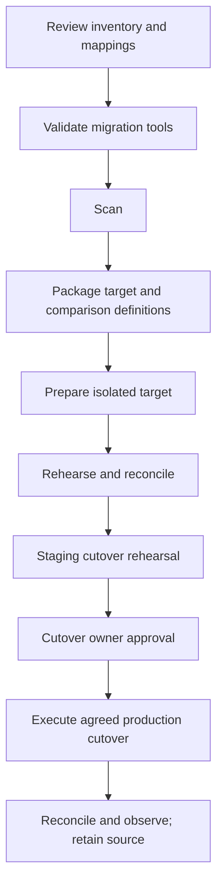
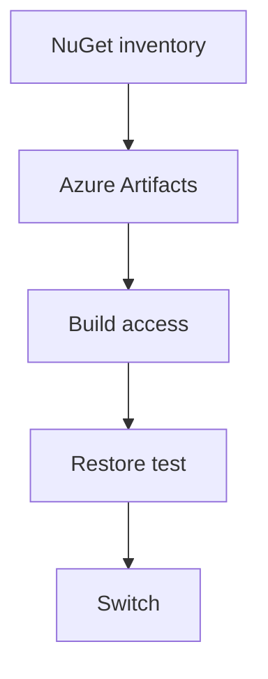

# P57 Retail NuGet Feed To Azure Artifacts Migration

**Cloud:** Azure  
**Industry:** Retail  
**Project type:** Migration  
**Resume occurrences:** 1

[Back to project index](README.md)

This guide preserves the extracted resume content and expands it into a proposed implementation flow. Confirm actual application and infrastructure details before using it as an execution runbook. Lab occurrences remain lab work.

## End to end objectives and CI/CD implementation

This is a complete reference delivery design for this title, including orchestration YAML, script contracts and project-specific execution. The actual application repository, credentials, resource names and infrastructure were not provided. The YAML will not deploy a real project until those values and the required project-owned scripts and Make targets are implemented and tested.

### A. Project objectives

- Business objective: Migrated internal retail application packages from a legacy NuGet feed to Azure Artifacts while validating build dependencies and access.
- Technical objective: implement the specific path NuGet inventory > Azure Artifacts > Build access > Restore test > Switch using the resume stack: Azure Artifacts, NuGet, Azure Pipelines, PowerShell, Git.
- Acceptance objective: Expected immutable versions restore successfully.
- Recovery objective: detect version mismatch or permission denial breaks builds and rehearse this response: Return feed references to the retained source without overwriting releases.
- Delivery objective: automate assessment, target preparation, comparison and rehearsal; require a separate accepted production cutover and reconciliation decision before source retirement.

### B. Business flow and delivery flow

**Business or operational path:** NuGet inventory > Azure Artifacts > Build access > Restore test > Switch.




The pipeline transports **Versioned inventory and target definitions, comparison checks, cutover and failback runbooks**. Source review, build/test signals and deployment identity are separate controls. One CI bundle is promoted through all environments; production does not fetch a new branch head. For container deployments, build and scan the image in CI, record its digest in the payload manifest and reuse that digest instead of rebuilding it per environment.

### C. Repository layout


```text
projects/P57/                  # application, runbook or migration source
infra/P57/                     # reviewed resource definitions and provider locks
environments/dev/                # non-secret dev configuration
environments/staging/            # non-secret staging configuration
environments/prod/               # non-secret prod configuration
scripts/P57/ci.sh
scripts/P57/verify-release.sh
scripts/P57/preflight.sh
scripts/P57/plan.sh
scripts/P57/execute.sh
scripts/P57/verify.sh
scripts/P57/rollback.sh
tests/P57/                     # unit, integration, negative and recovery tests
pipelines/P57/                 # pipeline YAML and buildspec files
Makefile                         # validate, test, scan and package targets
release/                         # generated artifacts; never commit credentials
```

### D. Environment and access preparation

1. Create the Azure DevOps repository, protected main branch and PR validation build policy. The example uses `pr: none`; Azure Repos PR validation is configured through branch policy. For other repository providers, configure the supported PR trigger explicitly.
2. Create the `P57-delivery-config` variable group with dev/staging/prod service-connection names and resource-group names. Store secrets through protected secret references; do not place them in ordinary YAML values.
3. Configure three scoped service connections, preferably using supported workload identity federation. Use separate identities and subscription/resource boundaries according to the environment design.
4. Pre-create `P57-dev`, `P57-staging` and `P57-prod` environments. Configure the required approvals/checks and exclusive production change control on the resources outside the YAML. Restrict pipeline permission to those resources.
5. Provision network access and tool versions. The hosted Linux agent is an example; use an isolated private agent when targets or dependencies require private connectivity. Pin the actual supported Terraform, Helm, kubectl, language and scanner versions in your agent setup.
6. Implement and validate the script contract below. Pipeline success must reflect real assertions rather than a script that merely prints a completed message.

### E. Azure Pipelines YAML

Save as `pipelines/P57/azure-pipelines.yml`. The production environment approval is an external prerequisite; the YAML alone does not install an approval rule.


```yaml
name: P57-$(Date:yyyyMMdd).$(Rev:r)
trigger:
  branches:
    include:
    - main
  paths:
    include:
    - projects/P57/**
    - infra/P57/**
    - scripts/P57/**
    - tests/P57/**
    - pipelines/P57/**
pr: none
pool:
  vmImage: ubuntu-latest
variables:
- group: P57-delivery-config
stages:
- stage: CI
  displayName: P57 — Retail NuGet Feed To Azure Artifacts Migration
  jobs:
  - job: ValidateAndPackage
    steps:
    - checkout: self
      clean: true
      persistCredentials: false
    - bash: bash scripts/P57/ci.sh
      displayName: 'P57: validate, test, scan and package'
      env:
        COMMIT_SHA: $(Build.SourceVersion)
        PROJECT_ID: P57
    - publish: $(Build.SourcesDirectory)/release
      artifact: P57-release
      displayName: Publish immutable release bundle
- stage: Dev
  dependsOn: CI
  condition: succeeded()
  displayName: Isolated rehearsal
  jobs:
  - deployment: P57_dev
    environment: P57-dev
    strategy:
      runOnce:
        deploy:
          steps:
          - download: none
          - download: current
            artifact: P57-release
          - task: AzureCLI@2
            displayName: 'P57 dev: migration'
            inputs:
              azureSubscription: $(devServiceConnection)
              scriptType: bash
              scriptLocation: inlineScript
              inlineScript: 'set -euo pipefail

                mkdir -p "$REPORT_DIR"

                mkdir -p "$PLAN_DIR"

                # Operate on the bundle produced by CI, not a fresh branch checkout.

                bash "$RELEASE_DIR/verify-release.sh" "$RELEASE_DIR"

                mkdir -p "$AGENT_TEMPDIRECTORY/P57-dev-src"

                tar -xzf "$RELEASE_DIR/source.tgz" -C "$AGENT_TEMPDIRECTORY/P57-dev-src"

                cd "$AGENT_TEMPDIRECTORY/P57-dev-src"

                bash scripts/P57/preflight.sh "$TARGET_ENV" "$RELEASE_DIR" "$REPORT_DIR"

                bash scripts/P57/plan.sh "$TARGET_ENV" "$RELEASE_DIR" "$REPORT_DIR"

                bash scripts/P57/execute.sh "$TARGET_ENV" "$RELEASE_DIR" "$REPORT_DIR"

                bash scripts/P57/verify.sh "$TARGET_ENV" "$RELEASE_DIR" "$REPORT_DIR"'
            env:
              PROJECT_ID: P57
              TARGET_ENV: dev
              CHANGE_MODE: migration
              RELEASE_DIR: $(Pipeline.Workspace)/P57-release
              REPORT_DIR: $(Agent.TempDirectory)/P57-dev-reports
              PLAN_DIR: $(Agent.TempDirectory)/P57-dev-restricted
              RESOURCE_GROUP: $(devResourceGroup)
          - task: PublishPipelineArtifact@1
            condition: always()
            displayName: Publish sanitized stage evidence
            inputs:
              targetPath: $(Agent.TempDirectory)/P57-dev-reports
              artifact: P57-dev-evidence
- stage: Staging
  dependsOn: Dev
  condition: succeeded()
  displayName: Representative validation
  jobs:
  - deployment: P57_staging
    environment: P57-staging
    strategy:
      runOnce:
        deploy:
          steps:
          - download: none
          - download: current
            artifact: P57-release
          - task: AzureCLI@2
            displayName: 'P57 staging: migration'
            inputs:
              azureSubscription: $(stagingServiceConnection)
              scriptType: bash
              scriptLocation: inlineScript
              inlineScript: 'set -euo pipefail

                mkdir -p "$REPORT_DIR"

                mkdir -p "$PLAN_DIR"

                # Operate on the bundle produced by CI, not a fresh branch checkout.

                bash "$RELEASE_DIR/verify-release.sh" "$RELEASE_DIR"

                mkdir -p "$AGENT_TEMPDIRECTORY/P57-staging-src"

                tar -xzf "$RELEASE_DIR/source.tgz" -C "$AGENT_TEMPDIRECTORY/P57-staging-src"

                cd "$AGENT_TEMPDIRECTORY/P57-staging-src"

                bash scripts/P57/preflight.sh "$TARGET_ENV" "$RELEASE_DIR" "$REPORT_DIR"

                bash scripts/P57/plan.sh "$TARGET_ENV" "$RELEASE_DIR" "$REPORT_DIR"

                bash scripts/P57/execute.sh "$TARGET_ENV" "$RELEASE_DIR" "$REPORT_DIR"

                bash scripts/P57/verify.sh "$TARGET_ENV" "$RELEASE_DIR" "$REPORT_DIR"'
            env:
              PROJECT_ID: P57
              TARGET_ENV: staging
              CHANGE_MODE: migration
              RELEASE_DIR: $(Pipeline.Workspace)/P57-release
              REPORT_DIR: $(Agent.TempDirectory)/P57-staging-reports
              PLAN_DIR: $(Agent.TempDirectory)/P57-staging-restricted
              RESOURCE_GROUP: $(stagingResourceGroup)
          - task: PublishPipelineArtifact@1
            condition: always()
            displayName: Publish sanitized stage evidence
            inputs:
              targetPath: $(Agent.TempDirectory)/P57-staging-reports
              artifact: P57-staging-evidence
- stage: Prod
  dependsOn: Staging
  condition: succeeded()
  displayName: Approved production change
  jobs:
  - deployment: P57_prod
    environment: P57-prod
    strategy:
      runOnce:
        deploy:
          steps:
          - download: none
          - download: current
            artifact: P57-release
          - task: AzureCLI@2
            displayName: 'P57 prod: migration'
            inputs:
              azureSubscription: $(prodServiceConnection)
              scriptType: bash
              scriptLocation: inlineScript
              inlineScript: 'set -euo pipefail

                mkdir -p "$REPORT_DIR"

                mkdir -p "$PLAN_DIR"

                # Operate on the bundle produced by CI, not a fresh branch checkout.

                bash "$RELEASE_DIR/verify-release.sh" "$RELEASE_DIR"

                mkdir -p "$AGENT_TEMPDIRECTORY/P57-prod-src"

                tar -xzf "$RELEASE_DIR/source.tgz" -C "$AGENT_TEMPDIRECTORY/P57-prod-src"

                cd "$AGENT_TEMPDIRECTORY/P57-prod-src"

                bash scripts/P57/preflight.sh "$TARGET_ENV" "$RELEASE_DIR" "$REPORT_DIR"

                bash scripts/P57/plan.sh "$TARGET_ENV" "$RELEASE_DIR" "$REPORT_DIR"

                bash scripts/P57/execute.sh "$TARGET_ENV" "$RELEASE_DIR" "$REPORT_DIR"

                bash scripts/P57/verify.sh "$TARGET_ENV" "$RELEASE_DIR" "$REPORT_DIR"'
            env:
              PROJECT_ID: P57
              TARGET_ENV: prod
              CHANGE_MODE: migration
              RELEASE_DIR: $(Pipeline.Workspace)/P57-release
              REPORT_DIR: $(Agent.TempDirectory)/P57-prod-reports
              PLAN_DIR: $(Agent.TempDirectory)/P57-prod-restricted
              RESOURCE_GROUP: $(prodResourceGroup)
          - task: PublishPipelineArtifact@1
            condition: always()
            displayName: Publish sanitized stage evidence
            inputs:
              targetPath: $(Agent.TempDirectory)/P57-prod-reports
              artifact: P57-prod-evidence
```

### F. CI packaging and immutable promotion

Save this wrapper as `scripts/P57/ci.sh`. Its Make targets are application/project-owned integration points, not included application source. Implement them according to the contract below. Payloads must contain the selected deployment unit and relevant test reports; avoid sensitive data and unencrypted Terraform state or plans.


```bash
#!/usr/bin/env bash
set -euo pipefail
: "${PROJECT_ID:?Set PROJECT_ID}"
: "${COMMIT_SHA:?Set COMMIT_SHA}"
# Required project-owned targets; implement these against the selected language and tools.
make validate PROJECT_ID="$PROJECT_ID"
make test PROJECT_ID="$PROJECT_ID"
make scan PROJECT_ID="$PROJECT_ID"
mkdir -p release/payload
make package PROJECT_ID="$PROJECT_ID" OUTPUT_DIR="$PWD/release/payload"
# CI source artifacts may be extracted ZIPs with no .git directory.
tar --exclude='./release' --exclude='./reports' --exclude='./.git' -czf release/source.tgz .
printf '%s\n' "$COMMIT_SHA" > release/source-revision.txt
printf '%s\n' "$PROJECT_ID" > release/project-id.txt
# A digest detects accidental changes; bucket/artifact access controls provide trust.
(cd release && find payload -type f -print0 | sort -z | xargs -0 -r sha256sum; sha256sum source.tgz source-revision.txt project-id.txt) > release/SHA256SUMS
cp "scripts/$PROJECT_ID/verify-release.sh" release/verify-release.sh
```

Save this verifier as `scripts/P57/verify-release.sh`.


```bash
#!/usr/bin/env bash
set -euo pipefail
bundle="${1:?Release directory required}"
cd "$bundle"
test -s source-revision.txt
test -s project-id.txt
test -f source.tgz
# Reject archive paths that could escape the isolated extraction directory.
if tar -tzf source.tgz | grep -Eq '(^/|(^|/)\.\.(/|$))'; then
  echo "Unsafe source archive path" >&2
  exit 1
fi
sha256sum -c SHA256SUMS
```

### G. Required script and artifact contracts

All scripts use `set -euo pipefail`, reject missing required values, avoid shell tracing of secrets and exit nonzero on a failed assertion. Stage hooks take three arguments: environment, release directory and report directory. They must put sanitized evidence into the report directory and keep sensitive plans/state in a separately restricted store.

| File or target | Project-specific implementation | Required behavior |
| --- | --- | --- |
| make validate | Lint inventory mappings, target configuration and comparison scripts | Exit nonzero on invalid inputs, missing schemas or invalid environment configuration. |
| make test | Run unit and contract tests plus safe fixtures for Retail NuGet Feed To Azure Artifacts Migration | Produce results without contacting production systems. |
| make scan | Run pinned secret, dependency and infrastructure scans relevant to the selected stack | Fail on the project-approved blocking rules and store sanitized results. |
| make package | Versioned inventory and target definitions, comparison checks, cutover and failback runbooks | Write versioned deliverables under OUTPUT_DIR; do not put secrets or sensitive inventories in the bundle. |
| preflight.sh | Verify target account/subscription, region, identity, required variables and rollback availability | Record the target and stop on mismatch. Assert CHANGE_MODE and TARGET_ENV before mutation. |
| plan.sh | Prepare source/target comparison and cutover readiness evidence | Save sanitized plan and stop conditions to REPORT_DIR; plan is not permission to perform destructive work. |
| execute.sh | Inventory identities, versions and pipeline consumers; Publish approved packages and validate feed permissions; Test scoped credentials and representative restores; Move consumers in waves and retain the old feed | In dev/staging use isolated targets. In prod perform only the approved change; keep retirement, destructive cleanup and incident replay separately authorized. |
| verify.sh | Expected immutable versions restore successfully | Test complete user paths and negative cases; exit nonzero on failure and record safe evidence. |
| rollback.sh | Return feed references to the retained source without overwriting releases | Require a selected accepted release and reconciliation decision; validate target identity and capture recovery results. Never silently auto-rollback data. |
| verify-release.sh | Validate immutable bundle paths and SHA256SUMS before extraction | Digest checks do not substitute for restricted artifact-store permissions. |

### H. Title-specific execution sequence

1. **Inventory identities, versions and pipeline consumers.** Record the relevant resource or revision, the validation result and the accepted next state before continuing. In production, use the scope accepted by the named owner; the pipeline must not broaden its own authority.
2. **Publish approved packages and validate feed permissions.** Record the relevant resource or revision, the validation result and the accepted next state before continuing. In production, use the scope accepted by the named owner; the pipeline must not broaden its own authority.
3. **Test scoped credentials and representative restores.** Record the relevant resource or revision, the validation result and the accepted next state before continuing. In production, use the scope accepted by the named owner; the pipeline must not broaden its own authority.
4. **Move consumers in waves and retain the old feed.** Record the relevant resource or revision, the validation result and the accepted next state before continuing. In production, use the scope accepted by the named owner; the pipeline must not broaden its own authority.

The following fragment illustrates the platform boundary for this project; fill its required variables from validated non-secret environment configuration and secure references. It is a fragment to integrate into the hooks, not a replacement for the full preflight, approval and verification flow.


```bash
# Execute from the immutable release checkout with a validated target identity.
# Inventory, comparison and cutover logic are specific to this migration.
test -f "$REPORT_DIR/accepted-rehearsal.json"
test -f "$REPORT_DIR/cutover-readiness.json"
# Implement these operations in execute.sh for this exact project:
# 1. Inventory identities, versions and pipeline consumers
# 2. Publish approved packages and validate feed permissions
# 3. Test scoped credentials and representative restores
# 4. Move consumers in waves and retain the old feed
# The approval record must identify current source, target and authoritative writer.
# Do not delete the source or replay business writes in this generic runner.
```

### I. Dev to staging to production walkthrough

| Stage | End to end behavior |
| --- | --- |
| Source review | A developer changes the source/configuration relevant to this title, links the work item and obtains required protected-branch review. CI validation is required before merge. |
| CI validation | Run the project-specific Make targets, test fixtures and blocking security rules. Failed scans or tests stop the release before any production credentials are used. |
| Package | Produce Versioned inventory and target definitions, comparison checks, cutover and failback runbooks. Record the commit and file digests. Preserve immutable registry/package identifiers if an external registry is involved. |
| Dev | Validate account/subscription and run preflight, plan, execute and verify against isolated resources. Inventory identities, versions and pipeline consumers. |
| Staging | Use representative isolated dependencies and rehearse the complete path, including version mismatch or permission denial breaks builds. Capture rollback and reconciliation results. |
| Approval | An owner reviews the source revision, artifact identity, staging tests, target impact, recovery readiness and any data reconciliation. Reject stale plans or unresolved business-state uncertainty. |
| Production | Recheck the real target and allowed scope, then promote the exact bundle. Move consumers in waves and retain the old feed. Stop on failed assertions. |
| Verification | Acceptance is: Expected immutable versions restore successfully. Technical deployment success without application-path tests is insufficient. |
| Recovery | On failure, stop further changes and preserve evidence. Return feed references to the retained source without overwriting releases. A separate controlled rollback uses rollback.sh and the previously accepted compatible release; the sample pipeline deliberately does not invoke an indiscriminate automatic rollback. |
| Handover | Publish sanitized execution results and named monitoring ownership. Keep source retirement, destructive cleanup, backlog replay and retention decisions separate from deployment completion. |

### J. Production stop conditions and acceptance

- Stop if the account/subscription, environment, approved revision or identity differs from the change record.
- Stop if any required test, signature/digest check, access review or plan comparison fails.
- Stop if business state is uncertain; resolve duplicate writes, files, messages or jobs with the application/data owner before retry or failback.
- Stop if version mismatch or permission denial breaks builds.
- Accept only when expected immutable versions restore successfully and the owner accepts monitoring and recovery readiness.
- Do not use fabricated latency, availability, transaction-volume or savings claims. Choose actual thresholds and observation windows with the owner.

### K. Platform reference documentation

- [Azure deployment environments](https://learn.microsoft.com/azure/devops/pipelines/process/environments)
- [Azure resource approvals and checks](https://learn.microsoft.com/en-us/azure/devops/pipelines/process/approvals?view=azure-devops)

## Detailed application, operations and recovery flow

The original complete project flow follows, including the extracted resume description, architecture, ten execution stages, tests, monitoring, incident response, security and resume references.

## Extracted resume content

**Extracted from the resumes**

Migrated internal retail application packages from a legacy NuGet feed to Azure Artifacts while validating build dependencies and access.

Skills used: Azure Artifacts, NuGet, Azure Pipelines, PowerShell, Git

- Inventoried package versions, consuming builds and feed permission requirements before transition.
- Published approved packages to the target feed and verified package identity and version resolution.
- Updated build configuration and scoped credentials, then tested representative application builds.
- Coordinated feed cutover and retained the legacy source until package-consumer validation was complete.
- Maintained a migration checklist covering configuration, access, validation, rollback and ownership.
- Compared source and target behavior using controlled test cases before documenting migration acceptance.

## 1. Purpose and implementation boundary

This migration flow concerns Retail NuGet Feed To Azure Artifacts Migration. Proposed acceptance condition: Expected immutable versions restore successfully. The detailed sequence below is a planning and learning expansion of the resume, not proof that these steps were performed in a client environment.

Confirm application language, repository URL, exact resource names, account or subscription structure, regions, versions, client identity, traffic volumes, SLOs, data-retention requirements and approval owners. These are not supplied in the resumes and are not invented here.

## 2. Architecture and main flow



**Flow:** NuGet inventory → Azure Artifacts → Build access → Restore test → Switch

The boxes show logical boundaries, not a verified deployed topology. Keep build or change identity separate from runtime identity; carry a release, incident or migration identifier across logs and handover records.

**Decision gate**

All stage checks pass? Continue to the next stage. A check fails? Stop promotion or traffic movement, preserve diagnostics and assess recovery. A business side effect may already exist? Reconcile it with the application owner before replay, rerun or failback.

## 3. Prerequisites and ownership

| Owner | Required input | Completion responsibility |
| --- | --- | --- |
| Application owner | Expected user journeys, dependencies, data contract and test examples | Accept functional behavior and reconcile business state |
| DevOps engineer | Source revision, resource inventory, pipeline access and tool configuration | Implement reviewed changes and capture validation results |
| Platform and identity owner | Network paths, deployment identity, runtime roles and approved secret references | Approve scoped access and environment readiness |
| QA or lab reviewer | Controlled fixtures and acceptance cases | Verify normal, negative and recovery behavior |
| Operations or incident owner | Baseline signals, alert routing and recovery contacts | Own monitoring, incident escalation and handover |
| Data owner when applicable | Authoritative copy, writer controls and reconciliation method | Approve synchronization, replay, data recovery and retention |

## 4. Detailed execution flow

### 1. Discover the source and dependencies

**Owner:** Migration engineer and service owner

Input: Source inventory and target requirement

Action: Record source versions, identities, network paths, runtime configuration, data ownership and all consumers of Retail NuGet Feed To Azure Artifacts Migration. Select a small representative rehearsal scope.

Output and gate: Dependency inventory and approved migration boundary

If the gate fails: Stop when a required consumer or recovery dependency has no owner.

### 2. Define target parity and cutover ownership

**Owner:** Platform, application and data owners

Input: Inventory and proposed target design

Action: Map every required source behavior to a target resource or documented exception. Name the authoritative writer or source of truth during each stage; agree the change window and stop conditions.

Output and gate: Target mapping, validation matrix and cutover decision record

If the gate fails: Do not proceed with unclear write ownership or unsupported target behavior.

### 3. Rehearse without affecting the source

**Owner:** Migration engineer and QA

Input: Isolated target and controlled sample workload

Action: Test provisioning, access and representative application journeys using synthetic or approved non-sensitive data. Capture a measured rehearsal and practice the return path.

Output and gate: Accepted rehearsal and tested recovery checklist

If the gate fails: Keep source production unchanged until the rehearsal and recovery are accepted.

### 4. Execute project stage 1

**Owner:** DevOps engineer with service owner

Input: Accepted output of the preceding stage and relevant resume tools

Action: Inventory identities, versions and pipeline consumers. Validate the result before moving to the next boundary in the architecture flow.

Output and gate: Stage record identifying the exact resource or revision, check performed and result

If the gate fails: On failure, stop progression and inspect version mismatch or permission denial breaks builds. Retain the last accepted state.

### 5. Execute project stage 2

**Owner:** DevOps engineer with service owner

Input: Accepted output of the preceding stage and relevant resume tools

Action: Publish approved packages and validate feed permissions. Validate the result before moving to the next boundary in the architecture flow.

Output and gate: Stage record identifying the exact resource or revision, check performed and result

If the gate fails: On failure, stop progression and inspect version mismatch or permission denial breaks builds. Retain the last accepted state.

### 6. Execute project stage 3

**Owner:** DevOps engineer with service owner

Input: Accepted output of the preceding stage and relevant resume tools

Action: Test scoped credentials and representative restores. Validate the result before moving to the next boundary in the architecture flow.

Output and gate: Stage record identifying the exact resource or revision, check performed and result

If the gate fails: On failure, stop progression and inspect version mismatch or permission denial breaks builds. Retain the last accepted state.

### 7. Execute project stage 4

**Owner:** DevOps engineer with service owner

Input: Accepted output of the preceding stage and relevant resume tools

Action: Move consumers in waves and retain the old feed. Validate the result before moving to the next boundary in the architecture flow.

Output and gate: Stage record identifying the exact resource or revision, check performed and result

If the gate fails: On failure, stop progression and inspect version mismatch or permission denial breaks builds. Retain the last accepted state.

### 8. Validate the complete application path

**Owner:** QA and application owner

Input: Completed technical steps and controlled fixtures

Action: Exercise the complete path through Build access to Restore test to Switch. Check a normal request, an access-denied case and a failed dependency. Reconcile any partial writes or repeated events.

Output and gate: Expected immutable versions restore successfully.

If the gate fails: If any acceptance check fails, keep the change unaccepted and use the recovery decision below.

### 9. Approve completion and observe stability

**Owner:** Change or incident owner

Input: Functional results and monitoring baseline

Action: Confirm that expected Azure logs, resource health and application signals are visible. Compare with the accepted baseline for an owner-agreed observation period; do not invent numerical SLOs or durations.

Output and gate: Owner sign-off, observation record and resolved exceptions

If the gate fails: Reopen the incident or stop the cutover when regression exceeds agreed limits.

### 10. Hand over and close

**Owner:** DevOps and operations owner

Input: Accepted service state and open follow-up actions

Action: Publish the runbook, version or configuration references, recovery procedure, alert ownership and known limitations. For migrations, defer source retirement until retention and reconciliation are signed off.

Output and gate: Operational handover and tracked follow-up work

If the gate fails: Leave risky cleanup or retirement pending rather than treating technical completion as automatic approval.

## 5. Project-specific integration checks

| Boundary | Required checks |
| --- | --- |
| Artifact identity | Record package or image version, digest where applicable, commit, build result and approved consumers. Reject unexpected version substitution and keep published releases immutable. |
| Delivery integration | Inventory triggers, branch rules, agent capabilities, environment approvals and connection identities. Prevent old and new triggers from starting the same production deployment. |

## 6. Validation matrix

| Test | Execution | Acceptance |
| --- | --- | --- |
| Normal flow | Run one controlled example across the complete architecture path | Expected immutable versions restore successfully |
| Denied access | Use a test identity without the required role | Access is denied, sanitized diagnostics are available and no permissions are broadened |
| Project failure | Rehearse this failure in isolation: Version mismatch or permission denial breaks builds | The failure is detected and the runbook identifies a bounded response |
| Unavailable dependency | Use a controlled dependency failure or safely simulated unavailable endpoint | Errors remain visible and the recovery path does not create uncontrolled retries |
| Repeated execution | Repeat the test or stage only in an isolated environment with a known initial state | State changes are reconciled; repeated execution does not silently duplicate a business operation |
| Recovery rehearsal | Practice the proposed recovery with compatible revisions and controlled state | Return feed references to the retained source without overwriting releases |
| Configuration isolation | Check target environment, identifiers and non-sensitive settings | No environment points accidentally to another environment or unauthorized endpoint |
| Operational readiness | Review logs, alerts, runbook, resource owner and follow-up ticket | An operator can detect the failure, identify the changed revision and invoke the approved recovery |

## 7. Monitoring and incident response

Use Azure Monitor, Log Analytics or Application Insights, as listed in the source. Enable only telemetry appropriate to the resources actually selected. Connect alert rules to named owners and choose thresholds from an agreed baseline rather than treating example numbers as production requirements.

| Signal | What to inspect | Response |
| --- | --- | --- |
| Application behavior | Synthetic request results, correctness and dependency errors | Correlate with the release or incident identifier and test the affected boundary |
| Project-specific symptom | Version mismatch or permission denial breaks builds | Pause further changes and isolate identity, configuration, runtime or data causes |
| Resource health | Availability, restarts, capacity and relevant service health | Compare with the baseline; approve bounded recovery before scaling or restarting |
| Identity or network denial | Sanitized authorization failures, DNS or routing errors | Check the intended identity and network path; avoid wildcard grants |
| Delivery or migration progress | Stage status, active revisions, remaining work and reconciled state | Stop progression on incomplete validation or unexplained divergence |
| Repeated failures | Recurrence, attempted recovery and known limitations | Escalate with a clear timeline and preserve failed-state diagnostics |

## 8. Rollback and recovery runbook

1. Declare the failed acceptance condition and stop new promotions, unsafe replays or further traffic changes. Keep one named incident or cutover owner.
2. Capture the current revision, relevant resource state, timestamps and sanitized errors. Preserve the previous accepted configuration and any required state backup.
3. Identify partially completed requests, messages, files, jobs or writes. Agree the authoritative state and writer before starting recovery.
4. Project recovery action: Return feed references to the retained source without overwriting releases.
5. Verify configuration, credential validity, schema and data compatibility. A compromised credential or an incompatible database schema must not be restored blindly.
6. Run the same complete-path normal and negative tests used for acceptance. Confirm both application behavior and resource health.
7. Observe for the agreed period and reconcile pending or repeated work. Retain source or prior revisions until recovery is accepted.
8. Document the failed gate, action, operator, recovered revision, outstanding risks and follow-up owner. Resume delivery only after the owner approves the new plan.

## 9. Security and operating controls

- Scope deployment and runtime identities separately. Prefer the approved non-interactive identity mechanism for the chosen stack and review service-to-service permissions.
- Keep credentials out of source, pipeline output, screenshots, tickets and flow documents. Use the approved secret store or protected reference supported by the selected architecture.
- Review private paths, ingress rules and allowed endpoints. A connectivity error is a reason to inspect the path, not to disable access controls.
- Use synthetic banking and retail test records. Sanitize logs and obtain application-owner approval before accessing sensitive data.
- Record the source revision, artifact or configuration version, approval and target environment. Retain change and incident history under the organization policy.

## 10. Deliverables and handover checklist

- Scoped architecture and dependency inventory for Retail NuGet Feed To Azure Artifacts Migration.
- Reviewed source, infrastructure or configuration references using the listed tools: Azure Artifacts, NuGet, Azure Pipelines, PowerShell, Git.
- Environment and identity mapping with secret references, excluding secret values.
- Execution checklist with stage outputs, stop conditions and named owners.
- Completed validation matrix, controlled test examples and unresolved exceptions.
- Rollback rehearsal and data or message reconciliation instructions when applicable.
- Monitoring configuration, alert routing, operating runbook and escalation contacts.
- Final owner acceptance and a follow-up list for source retirement, retention, cleanup or improvements.

## 11. Walkthrough for study or discussion

Explain the objective first: Migrated internal retail application packages from a legacy NuGet feed to Azure Artifacts while validating build dependencies and access. Then walk through NuGet inventory → Azure Artifacts → Build access → Restore test → Switch. Describe the four project-specific execution stages, how version mismatch or permission denial breaks builds would be detected, and why the recovery action is return feed references to the retained source without overwriting releases. Finish with the acceptance tests and operating handover. Describe only work actually performed; keep proposed steps and labs labeled accordingly.

## 12. Resume references

| Student | Cloud resume | Project number | Resume title | Context |
| --- | --- | --- | --- | --- |
| Sudhakar Kumar | Azure | 3 | Retail NuGet Feed to Azure Artifacts Migration | Resume draft |
